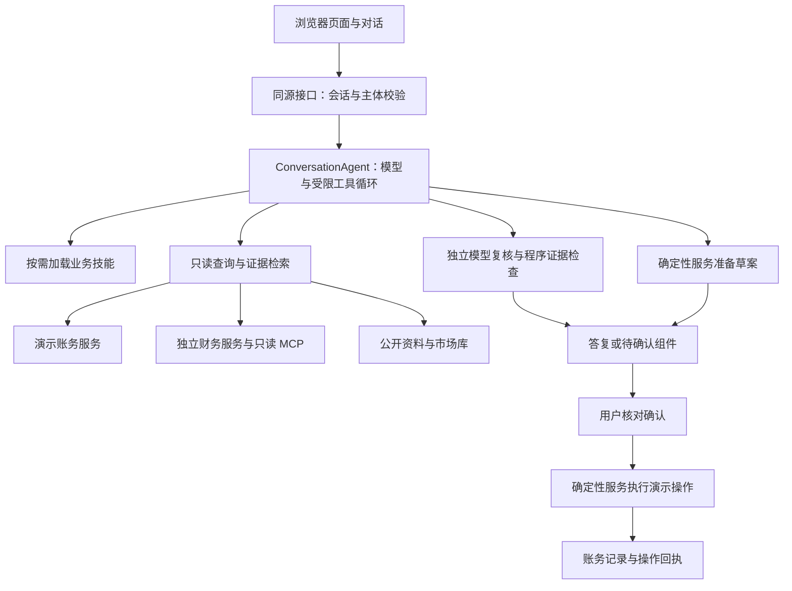

# Navren 技术说明

本文描述仓库已经提交的系统分工与接入边界。历史方案、旧评测结果与计划事项不作为当前实现证明；具体功能是否可用还取决于部署配置、数据覆盖和相应验收。

## 请求与执行链

浏览器通过 `/api/agent` 提交问题。当前默认编排位于 `agent_runtime/conversation.py`；`agent_core.py` 保留的旧实现不能作为当前默认调用链说明。

Agent 选择已接入工具、加载技能并组织回答。工具参数和返回结果受程序合同约束，个人金额由账务或财务计算服务提供，不能由模型自行补造。正文及草案需满足对应证据与审核要求；工具循环、调用时间和处理预算均有限，失败必须保留明确状态。

会话与可信宿主决定当前主体和授权范围。模型不能指定数据库路径、切换用户、直接运行任意 SQL，或凭聊天中的“确认”执行金融变更。金融写操作走独立准备、核对、确认与回执流程，权限、适当性、余额、限额、并发和幂等由确定性服务负责。

## 数据分层

| 层 | 主要模块 | 边界 |
|---|---|---|
| 演示运行账本 | `simulated_bank/`、`finance_gateway.py` | 记录演示余额、资金变更与业务回执；不调用真实银行资金接口 |
| 独立历史财务库 | `financial_data_service/`、`financial_mcp/` | 读取体验画像的账户、历史流水和分析；须显式配置已有数据库 |
| 导入账单 | 账单导入与分析模块 | 独立保存，不能当作已接入银行余额或已执行交易 |
| 公开资料 | `webank_catalog.py`、`local_knowledge/`、市场模块 | 保留出处、披露日期、版本和可用范围；公开目录不证明实时可买性 |
| 个人规划与记忆 | 日历、目标、图谱及个人资料模块 | 计划、推演与实际支付分别表达；保存计划不直接扣款 |

金额、币种、主体、时间范围、来源与版本须一并核对。账户现金与投资持仓属于不同存量；期间收入与支出属于流量，不能直接与资产余额相加。历史月报只能解释其覆盖期间，不能把较晚发生的运行操作混作同一历史依据。

仓库中的旧产品样例与历史评测资料不构成真实在售产品清单，也不证明持续收益行情、底层资产穿透或机构认可。当前公开产品查询须以接入资料及披露范围为准；缺少净值、收益期间或对应来源时应显示缺项。

## 模型、技能与语音

主对话和独立复核经 AI Ping 访问配置的 DeepSeek 与 GLM 模型。具体模型标识以已提交适配器配置为准，不把旧方案中的型号作为当前配置。Jev 相关代码及对照实验保留独立接入与验证范围，不能据其存在声称它已承担全部生产任务。

业务技能由 `agent_runtime/skills/` 提供，按需加载。技能说明提供业务流程和工具使用约束，本身不授予数据库或金融执行权限。

语音由百炼 Qwen 的识别与合成服务提供，通过同源语音接口连接后端，后端持有凭据。浏览器需支持相应音频能力并获得麦克风权限。当前主对话链不提供聊天图片内容解析；上传控件或历史多模态函数的存在不能作为可用证明。

## 独立财务 MCP

MCP 提供只读财务工具，由可信宿主为子进程绑定当前主体与数据位置。配置缺失、数据库不存在或工具连接失败时须报告不可用，不能自动创建空库掩盖缺项。它不提供直接转账、申赎或保单办理工具。

安装、启动合同和迁移说明见 [财务 MCP 说明](financial_mcp/README.md)。已有加密资料、主体映射及账务状态必须在迁移中保留；不能通过更换路径或新建空环境冒充完成迁移。

## 市场内容与部署

公开原文采集、证据检查、模型草稿和独立复核分工处理精选与周报。采集时间不等于事件发生时间或原文发布日期，失败不能通过改日期将旧内容伪装成新内容。HTTP 数据采集与模型生成、解读的成本需分开统计。

`server.py` 的基础启动仅监听本机。服务器上线需另行配置鉴权、HTTPS、WebSocket 代理、密钥注入、数据库持久化、后台任务及故障恢复，并验证部署后的真实请求路径。公网体验入口为 [https://navren.cn/](https://navren.cn/)，体验可能需要注册或登录；开发端口及作者本机路径不能作为他人的访问入口。

## 验收原则

源码存在、页面返回成功、历史通过记录与模型复核意见都不能独立证明功能完成。验收应覆盖相应的用户操作路径、数据来源与期间、确认状态、回执、刷新后的持久化及跨主体隔离。

本机生成的验收报告和截图不随仓库发布。公开文档只链接已提交的源码或材料；历史报告保留原测试日期、版本和结论，不冒充当前版本重新测试的结果。第三方来源及许可证见 [第三方材料说明](simulated_bank/THIRD_PARTY_NOTICES.md)。
