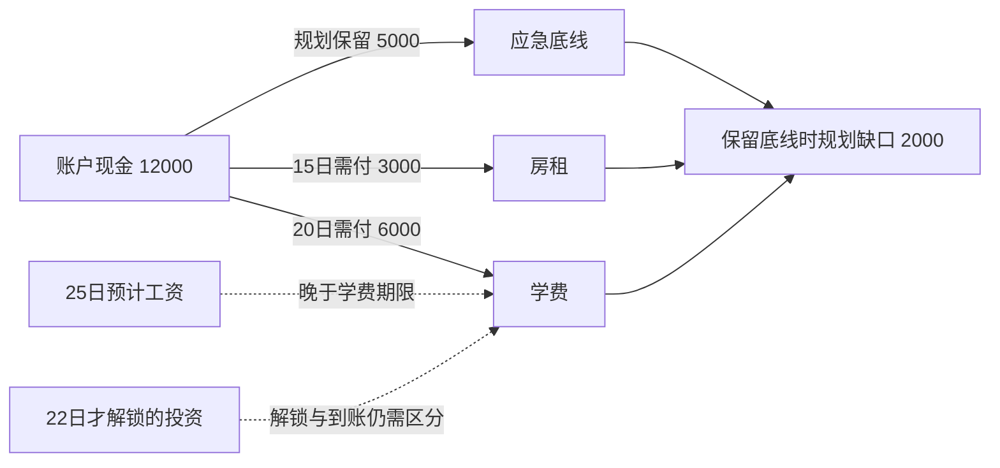

# Navren 个人财务知识图谱重构方案

> 历史设计或实施记录：保留文内注明版本的测试结论，不能作为当前版本的验收结果。当前实现与运行方式见 [README](../README.md) 和 [技术说明](../TECHNICAL.md)。本机机器信息已清理，未发布的历史产物不提供仓库链接。

日期：2026-10-05。性质：代码诊断、论文研究与实施方案。本轮仅新增本文件，没有改造应用、修改用户记忆或发布已验证的效果指标。

执行目录：`项目根目录`。执行者先读取最新代码和当前 AGENTS.md，保留其他窗口的改动。本方案与市场资讯、财务日历共用证据与日期边界，不重复实现已有底座。

## 1. 设计结论

把当前“个人资料关系图”升级为能解释资金约束、揭示跨领域联系、比较不同选择的个人财务知识图谱。

用户需要从图中得到三种结果：**理解一项变化、发现一项约束、比较一个选择**。每次打开不要求从“我”开始探索，而从一个问题、目标、账单或有依据的发现进入。

消费、收入、理财、偏好可以成为底层对象或属性。顶层板块按用户问题划分：资金去向、生活成本与价值、目标取舍、未来周转、共同风险。“日常开销”是支出的一个子集，“消费”与“支出”有重叠；把它们平行摆放会造成重复和含义不清。

一个节点是否值得加入，取决于它能否参与一条有用的关系路径。“我喜欢咖啡”“我有银行卡”可保存为资料，但不必占据默认图谱画面。

## 2. 当前代码为什么难以产生价值

本次直接检查 `personal_graph.py`、`user_memory.py`、`js/personal_graph.js`、`js/mine.js` 及银行档案合同：

| 现状 | 影响 | 重构方向 |
|---|---|---|
| 账户、职业、目标、合同和偏好多连接到 `self` | 展示归属，缺少业务依赖 | “我”保留为权限主体；默认展示资金、事件、目标之间的关系 |
| 流水按类别→商户聚合，只保留次数、最近日期等信息 | 无法比较两次大额消费与多次小额消费，也不能解释变化 | 保存金额、期间、账户、交易类型、匹配和覆盖情况 |
| 聚合边的 `source_ref` 实际只保留首笔交易 | 一条引用不能证明整组汇总 | 汇总关系引用完整输入记录集合或可复算查询及其版本 |
| 合同/目标/持仓主要挑名称和状态，没有带入关键金额与期限 | 无法形成资金可用、目标冲突或到期约束 | 使用已有结构化字段，增加缺失的分配与规则数据 |
| 记忆库已有 `supports/conflicts_with/depends_on/related_to`，图谱未加载 | 已保存的跨记忆联系在图里消失 | 读取有效关系，映射其真实语义与确认状态 |
| `read_relevant(workspace, question, workflow)` 未实际使用 `question` | 不能按当前问题选择相关关系 | 用问题、实体、期间及关系查询取得有限子图 |
| 前端主要是三维旋转、标签搜索和邻居查看 | 找到资料后仍不知道有什么发现、怎样行动 | 问题入口、结论、关系路径、证据、试算形成闭环 |
| 浏览器档案与服务端银行档案/记忆并存 | 名称相同不代表事实一致 | 确定权威来源，按字段核对，不自动合并旧本地资料 |

现有来源标识、本人确认和待核实资料区分值得保留；这部分是可信底座，但还缺少财务语义和分析。

## 3. 论文与权威资料怎样支撑底层

下表区分论文结论与 Navren 的设计选择。研究支持采用某种方法，不等于 Navren 已提高收益、准确率或比赛成绩。

| 依据及状态 | 原文直接支持的内容 | Navren 对应设计 |
|---|---|---|
| Hogan 等，**Knowledge Graphs**，2021，ACM Computing Surveys 54(4)，Article 71，1–37，已发表综述。[论文与刊物信息](https://arxiv.org/abs/2003.02320)，[DOI](https://doi.org/10.1145/3447772) | 图数据模型、语义、查询与校验；上下文部分讨论来源、时间及复杂关系表达 | 有类型实体与关系；交易/资金分配用事件对象表达；关系附来源、时间与生成规则，不能只有标签连线 |
| Snodgrass、Ahn，**A Taxonomy of Time in Databases**，1985，ACM SIGMOD，236–246。[作者原文](https://www2.cs.arizona.edu/~rts/pubs/SIGMOD85.pdf)，[DOI](https://doi.org/10.1145/318898.318921) | 区分现实有效时间、数据库记录时间与用户定义时间 | 分开事件发生/资料生效时间与系统获知/修订时间；可以重现当时依据，避免新陈述直接覆盖历史 |
| Campbell，**Household Finance**，2006，The Journal of Finance 61(4)，1553–1604。[作者页面](https://campbell.scholars.harvard.edu/publications/household-finance-presidential-address-american-finance-association)，[作者全文](https://campbell.scholars.harvard.edu/sites/g/files/omnuum5881/files/campbell/files/householdfinance_jof_2006.pdf) | 家庭通过金融工具实现目标，并面对长期期限、人力资本、非流动资产和借款约束 | 连接目标、劳动收入、资产流动性和负债义务，深入到分类支出之外 |
| Cocco、Gomes、Maenhout，**Consumption and Portfolio Choice over the Life Cycle**，2005，The Review of Financial Studies 18(2)，491–533，DOI 10.1093/rfs/hhi017。[作者机构摘要](https://www.insead.edu/faculty-research/publications/journal-articles/consumption-and-portfolio-choice-over-life-cycle) | 生命周期模型同时考虑消费、劳动收入风险、投资与借款约束 | 理财资金判断需要结合收入与未来需求；不把账户余额直接当可投资金额，也不按年龄机械推荐比例 |
| Heer、Bostock，**Crowdsourcing Graphical Perception: Using Mechanical Turk to Assess Visualization Design**，2010，ACM CHI，203–212。[作者全文](https://homes.cs.washington.edu/~jheer/files/2010-MTurk-CHI.pdf)，[DOI](https://doi.org/10.1145/1753326.1753357) | 对空间编码、面积、图表参数等进行感知实验，说明视觉编码需要检验 | 大小与线宽辅助发现规模，精确比较仍附金额/条形图；多种编码组合必须在本产品验证 |
| W3C **PROV-O**，2013，正式推荐标准，属于标准而非论文。[规范](https://www.w3.org/TR/prov-o/) | 表达实体、活动、责任主体、派生和修订等来源关系 | 结论关联输入证据、计算过程、模型解释和修订；“派生自数据”不等于现实因果 |

本次读取了图谱研究、时序研究、Campbell 与可视化原文的相关内容；Cocco 一文核实了刊物信息与机构摘要，没有据此宣称复现完整模型。

较新的工程参考可阅读 Rasmussen 等 2025 年 **Zep: A Temporal Knowledge Graph Architecture for Agent Memory**，[原始预印本](https://arxiv.org/html/2501.13956v1)。它讨论原始记录与衍生事实、时间与实体消歧；本次记录未显示正式期刊/会议发表信息，不能代替上述理论底座，也不要求引入其服务。

产品目标参考 [CFPB 财务福祉框架](https://www.consumerfinance.gov/consumer-tools/educator-tools/financial-well-being-resources/explore-findings/)：掌控日常财务、承受冲击、实现目标、保有生活选择。其[现金流预算工具](https://www.consumerfinance.gov/documents/10038/cfpb_creating-cash-flow-budget_tool_2021-08.pdf)强调收支发生时点。已有银行产品 [Bank of America Life Plan](https://info.bankofamerica.com/en/digital-banking/life-plan)将目标与资金账户、里程碑和进度关联；[DBS 的资金预测说明](https://www.dbs.com.sg/personal/financial-planning/your-money-forecast.page)分别描述现金流、资产和预测假设。这些是可借鉴的产品实践，不证明它们使用相同图谱。

## 4. 五个用户板块

五个板块是同一个图谱的不同查询视角，数量可随验证结果调整；不对应五个 Agent，也不复制五套数据。

### 4.1 资金去向与变化：钱为什么少了

关系路径：收入/消费事件→实际账户→类别/商户→退款或应收→期间净变化；预算与上期对照连接到变化节点。

回答：本月增加的开销主要来自哪里？餐饮金额增加是次数更多，还是平均每笔更高？银行卡余额下降是买入理财还是生活消费？

增加“变化贡献”而不仅是金额排名。若两期范围可比，支出可分解为交易次数与平均每笔金额的变化；客单价变化包含消费组合变化，不能写成商品价格上涨或动机判断。类别迁移、缺失账户与不完整月份须先处理。

内部转账、退款、贷款发放、理财申赎与真实经营/劳动收入分别建模。信用卡消费与还款只能在对应口径下计算一次。待退款/报销/AA 应收与实际到账分开，不能把待收金额加入当前可用余额。

### 4.2 生活成本与价值：哪些支出形成长期约束

关系路径：生活需要/用户明确价值→消费或服务合同→扣款授权→实际费用→未来义务→影响的资金余量/目标。

回答：哪些是一次性购物，哪些会持续占用资金？续费金额是否变化？哪些重要生活内容想保留，有没有用户愿意比较的替代方案？

“一年成本”要区分已发生费用、合同剩余义务与假设续费：月付 50 元乘 12 得到的是按当前价格持续一年时的情景金额，不是已花 600 元。关闭银行代扣不等于解除服务合同。

偏好作为用户选择的约束，例如“保留健身”“避免资金锁定”“旅行优先级高”。仅凭消费次数不能推断喜欢、浪费、冲动或会员闲置。首次确认后记录适用期间、范围与例外；调整建议尊重用户价值，而不统一追求支出最小。

### 4.3 目标与资金取舍：同一笔钱正在支持哪些计划

关系路径：目标金额/期限/优先级→已确认资金分配→账户或资产批次→可用日期；同一资源→其他目标/资金保留→约束。

回答：进修和旅游是否重复算了同一笔存款？目标缺口是金额不足还是资金到期太晚？推迟一个目标与调整一项开销，分别改变什么？

区分目标自报已存额、规划分配与真实资金预留。现有 `wealth_goals.saved_minor` 没有资金归属明细，不能直接生成“某账户已为目标专款预留”的边。新增分配记录后才允许计算重复占用；优先级由用户确认。

情景可比较目标金额/截止日/每期投入变化，明确保持哪些条件不变。没有完整可分配现金流，不显示精确的“提前几个月完成”或实现概率。

### 4.4 周转与未来承诺：有资产为什么仍可能临时紧张

关系路径：期初可用资金→已确认账单与付款日→资金低点；预计收入/产品解锁/赎回结算→可能补足的日期→受影响账单。

回答：月度有结余，为何某个日期仍不够？账单早于工资到账，会影响什么？理财解锁后是否真的来得及到账？

复用 `cashflow_timeline.py` 和日历情景能力，把同一份计算结果同时呈现为日期视图和关系路径，避免两个模块出现不同答案。日历回答“何时”，图谱解释“哪些关系决定结果”。

分别显示实际余额、基于已知义务的情景、加入候选续费/用户预计收入的情景。未来工资、未提交赎回与锁定期结束不等于已到账。应急底线、实际账户冻结和规划分配分别处理，避免重复扣减。

### 4.5 共同风险与外部影响：分散的对象是否依赖同一因素

关系路径：已确认收入来源/企业→行业或风险因素←有证据的资产暴露；另一条是利率/汇率变化→适用合同条款→现金需求/目标。

回答：收入和投资是否同时依赖同一行业？多只产品是否重复暴露于同一底层资产？市场热点与本人哪项已知合同或资金安排有关系？

这部分比分类汇总更深入，但数据门槛也更高：需要经核验的雇主/行业映射、产品成分及日期、贷款重定价条款等。当前产品主要是本金/大类口径，不能按名称猜持仓行业比例。无法穿透的资产显示未覆盖部分，不输出完整分散度结论。

共同暴露是潜在依赖，不能据此伪造相关系数、失业概率或确定损失。冲击大小与发生时间由用户选择情景或来自明确模型，并展示假设。

金融知识和兴趣嵌入解释路径：用户问某条关系时展开相关概念、适用条件与权威材料；历史提问只能表明曾关注，不自动证明理解或适合购买对应产品。公共知识与个人事实分开存储。

## 5. 底层数据模型：事件、关系、证据、分析分层

### 5.1 实体与关系的语义

核心实体包括账户、资产/持仓批次、负债、收支事件、费用/合同承诺、目标、资金分配、商户/收款方、本人确认的价值偏好、风险因素、金融概念。用户身份是权限与归属边界，不必作为可视化中心。

多方关系用事件或分配对象表达。例如一笔交易同时涉及账户、金额、币种、时间、对手方和类型，不能压成“我→餐饮”后丢失属性。

| 有类型的关系 | 含义与必要证据 |
|---|---|
| `posted_to` / `paid_from` | 实际入账/付款对应账户，来自流水记录 |
| `refund_of` / `settles` | 退款对应原消费；实际到账结清某应收，唯一匹配或本人确认 |
| `governed_by` / `charged_under` | 合同条款/费用关联，不能只按商户名称匹配 |
| `allocated_to` / `reserved_for` | 用户规划分配与真实预留分别记录，不互相替代 |
| `available_on` / `requires_by` | 资金可用时间与目标/账单期限，附规则与状态 |
| `supports` / `depends_on` / `conflicts_with` | 明确资料关系或已计算约束；保存含义和依据，不自动推断价值冲突 |
| `exposed_to` | 企业/产品对应风险因素，附原始组成资料、暴露量及未覆盖部分 |
| `explained_by` / `derived_from` | 分析引用概念或派生自证据，不代表现实因果 |

资金具有可替代性。没有真实分配记录时，可以说“该账户的入账与支出共同决定结余”，不能画出“这笔工资具体支付了那杯咖啡”的确定流向。

### 5.2 四类记录与独立情景

1. **原始事件/资料**：结构化银行记录、导入账单、用户确认资料、合同、公开权威材料；保留版本和读取范围。
2. **关系断言**：对象间有类型的联系，注明直接记录、用户确认、确定性推导或待核实匹配。
3. **分析结果**：金额分解、覆盖、期限冲突、共同暴露等，引用完整输入与计算版本；只读、可重算。
4. **记忆与解释候选**：消费目的、稳定偏好等；本人确认后才进入对应正式语义。

**情景**单独存储假设及影响，不能覆盖以上真实记录或自动产生业务操作。重复出现不把候选自动晋升为事实。

建议沿用 SQLite 作为原始业务事实和版本记录的持久化基础，NetworkX 作为可重建查询/分析投影。当前规模不需要先换成 Neo4j、训练图神经网络或让模型补全财务事实。数据库产品不能替代实体语义与质量规则。

### 5.3 每条关系必须包含的上下文

```text
relation_id、subject_id、predicate、object_id
user/workspace/source_scope、record_version、ontology_version
amount_minor/metric_value、currency/unit、metric_definition、period
occurred_at 或 valid_from/valid_to
recorded_at/superseded_at
source_refs、derivation_type、method_version
status、coverage、assumptions、scenario_id（仅情景使用）
```

实际持久化区分实体、事件、断言、证据引用、计算输入输出、资金分配、情景。主外键、类型、金额与币种由 schema 验证，不能全部塞进没有约束的文本 JSON。需要多条证据时使用关系表保存，不截成第一条来源。

建议数据表职责如下，最终命名按仓库约定调整：

| 表 | 核心字段与职责 |
|---|---|
| `graph_entities` | 实体 ID、类型、工作区、原始对象 ID、来源范围与版本；不替代银行账本 |
| `graph_events` | 事件 ID、事件类型、发生/到期/结算时间、金额/币种、账户及对手方；关联原始记录 |
| `graph_assertions` | 主语、关系、宾语、有效时间、记录时间、确认/失效状态及生成方式 |
| `graph_evidence_links` | 断言或分析 ID→一个或多个原始证据 ID/版本，保存派生依赖 |
| `graph_calculations` | 指标定义、完整输入引用、期间、程序版本、结果、覆盖与假设；支持重算和失效 |
| `goal_allocations` | 目标 ID、资源 ID、金额/币种、适用时间、用户确认及分配类型；规划分配不改变余额 |
| `graph_scenarios` | 假设参数、基线版本、变更项目、计算输出；与正式事实隔离 |

原始金额与关系来源先校验，才生成前端尺寸/线宽。渲染属性属于可重建视图，不作为金融事实重新进入记忆。

两种时间对应“当时何时成立”与“系统何时知道/更正”；账单到期日、估值日、结算日另有明确字段，不都叫更新时间。用户删除个人资料后，派生结果及索引随之失效；保留审计所需最少信息，不借历史版本重新向用户暴露已删除内容。

状态包括已发生、本人确认、合同计划、统计观察、待确认匹配、假设、失效。模型自报的置信度不是正确概率；不通过一个 0.9 分数将财务推测包装成事实。

导入数据和模拟银行保持独立来源范围。当前图谱替换了交易来源后仍可挂入模拟合同/目标；重构后不能把这些节点静默拼成用户的真实完整财务图。允许显式模拟叠加或试算，但标明来源并单独计算。

每个用户的个人实体、记忆、证据和派生查询隔离；权限主体从经过验证的服务端会话取得，不能信任模型或客户端自行提交的用户 ID。公共金融概念可共享，用户私有关系不可跨用户检索；现有本机模拟工作区不应被描述为已经具备生产级多用户授权。

金额使用整数分或明确精度的 Decimal。不同币种分别聚合；需要换算时展示汇率、日期与来源。未知、未导入和零值分别表示。

### 5.4 金融事件的口径映射

现金流、生活消费、融资成本和资产/负债变化分别记账，同一事件可有多个经济维度；用户切换视角时不能直接重复累加。

| 事件 | 现金流/资产负债变化 | 消费或收入解释 |
|---|---|---|
| 工资实际到账 | 对应账户现金增加 | 有工资来源依据的劳动收入 |
| 可识别内部转账 | 账户间变动；完整覆盖相关账户时合计抵消 | 不算生活消费或新增收入 |
| 信用卡购买与后续还款 | 购买形成对应负债；还款减少现金与负债 | 购买按选定口径记消费，后续本金还款不再计消费；利息/费用单列 |
| 贷款发放 | 现金与负债增加 | 不算工资等真实收入 |
| 贷款还款 | 本金减少现金和负债；利息/费用减少现金 | 本金不计生活消费，利息/费用进入对应融资成本 |
| 理财买入/赎回 | 现金与份额/持仓变化，结算前后区分 | 本金申赎不算生活消费或劳动收入，损益按完整估值与成本数据另算 |
| 退款/报销/AA 回款 | 实际到账增加现金，与原事件或应收关联 | 退款抵减对应支出；报销/AA 回款按已确认承担关系冲销，不冒充工资 |

退款跨期时明确采用本期净现金流还是原消费期间重述口径，不悄悄更换历史统计。无法关联的入账保留未分类状态，不能为了完整图形自动归为收入。

## 6. 构建与问答工作流

```text
授权范围内的结构化记录/用户确认资料
→ 字段校验、来源版本、实体消歧、跨源去重
→ 有类型事件与关系（匹配不确定则候选）
→ 时间与口径校验
→ 按用户问题选择相关路径
→ 确定性金额/日期/约束计算
→ 主模型解释 + 独立审核 + 程序校验
→ 结论、有限子图、证据、可选情景
```

先用工作区内部稳定 ID 确认对象；不同来源中的同名商户、账号、产品不能仅靠字符串直接合并。跨源身份映射和退款/应收匹配必须能解释并被修正。模型可提出候选实体和关系，不负责改余额、创造关联或执行金融操作。

检索按“当前问题+对象+期间+来源”缩小范围，再进行图遍历；文本/语义检索用于定位陈述和概念，不能把相似度作为资金关系证据。典型子图默认约 5—12 个节点，必要时逐步展开，2—3 跳是界面初值而非硬性数学限制。

返回结构中包含 `answer/insight_id`、`subgraph`、`metric_definitions`、`evidence_refs`、`as_of`、`coverage`、`assumptions`、`available_actions`。聊天与“我的”读取同一版本。点击图上的对象可以问 Navren，并传递对象/分析 ID，不只传一个标题。

一个完整洞察必须回答：发现了什么；哪些记录和关系支持它；覆盖到哪里；用户可以比较什么。缺数据时具体说明缺哪个字段，不能只泛泛提示“资料不足”。

## 7. 大小、颜色和线宽的表达规则

默认用稳定的二维关系布局，三维保留为可选探索模式。定量比较避免依赖三维球体的体积、透视和遮挡；用户需要能读金额、时间和方向。

| 视觉通道 | 表达什么 | 约束 |
|---|---|---|
| 节点大小 | 当前视角选定的金额/需求/占用规模 | 按同类对象、同币种、同期间/时点比较；不用节点度数或提及次数代表财务重要性 |
| 节点填充颜色 | 对象类型，例如资金、义务、目标、偏好 | 全产品语义稳定，不将红色直接解释为某类消费“坏” |
| 边框与状态徽标 | 已计算的缺口、过期、待确认等需关注状态 | 状态条件明确，配图标与文字，不只依靠红绿或深浅 |
| 连接线粗细 | 某条可量化关系的金额、分配量或同口径暴露量 | 非定量关系细线；不以语义相似度/模型置信度充当影响强度 |
| 箭头与关系文字 | 付款方向、分配方向、条件依赖等实际语义 | 图中每种线有动词；条件依赖箭头与资金流动箭头在图例中区分 |
| 实线/虚线/点线 | 已发生；已确认未来计划；待确认或情景 | 虚线不是弱关联；点线再配候选/假设标签，避免状态混淆 |
| 路径高亮 | 当前问题相关的证据路径 | 高亮表示正在查看，不等于更高风险或更强因果 |

建议类型色：资金蓝、义务暖棕、目标绿、偏好/知识紫；缺口和异常使用边框/徽标强调。具体颜色需验证背景对比度、色觉差异和选中状态。

### 大小与尺度

默认金额视角采用面积映射，圆半径与金额规模的平方根相关。变化贡献、净额等有正负时，规模取绝对值，正负通过方向、加减号和文字表达；金额缺口与余额分别标明含义，不能让符号消失。若增加最小可点击尺寸或上限，则图例注明最小显示/封顶处理，不能声称仍完全按面积精确成比例。零值显示“0”及最小标记；未量化的合同/知识概念用固定尺寸和“未量化”说明，不以零值伪装未知。

资金存量和期间支出流量不共享一个含糊的“大意味着更多”图例。必要时分栏或按节点类别分别给尺寸图例：账户大小表示指定时点可用金额，支出大小表示所选期间净额。不同类别之间不引导面积比值比较。

线宽使用单调、有界的映射，同一关系类别统一尺度；附准确值。金额跨越过大时可选择明确标记的压缩/分档模式。切换“金额/次数/占比”时同步更新大小、线宽和图例，一张图默认只保留一个主要规模指标；占比注明分母。

偏好不能靠模型自打 8/10 分决定大小。用户确认的优先级可用高/中/低文字或序号表达，与金额大小分开。

### 交互与可读性

进入页面先显示近期少量有依据的发现，再选择问题子图。提供时间、来源、视角选择；点击节点看相关事实，点击线看关系定义、金额、期间、计算及来源。不能只显示邻居列表。

默认不展示全部商户、家庭成员与偏好。同类节点可聚合并展开，布局在刷新后尽量稳定；用户选择不引起画面持续抖动。移动端提供路径列表/卡片，键盘可访问，金额和状态始终有文字替代。

图谱与条形图/日历配合使用：金额排名用条形图更易精确比较，日期用日历，跨板块依赖用关系图。节点数与视觉复杂度不作为价值指标。

## 8. 一条完整演示：资产与目标之间的时间约束

以下全部是假设例子，不是当前账户的真实测算结果。

假设 10 月 10 日账户现金 12,000 元，用户希望保留应急金 5,000 元，10 月 15 日房租 3,000 元，10 月 20 日学费 6,000 元；工资预计 10 月 25 日到账，但没有保证。另一笔投资 10 月 22 日才解除锁定，到账规则仍需核验。



程序计算 `12000 - 5000 - 3000 - 6000 = -2000`：这是**保留应急底线前提下的规划缺口**，不是账户已负余额；支付后现金仍可能为 3,000 元。图的价值是解释“总资产够”与“期限内可用并保留底线”之间的差别。

用户可比较调整付款日期、分配、目标期限或应急底线的情景；真正转账、赎回、修改付款安排仍复用现有确认与规则边界。不能因在图里拖了一条线就执行操作。

## 9. 当前数据能支持到什么程度

| 关系能力 | 当前基础与缺口 | 实施处理 |
|---|---|---|
| 已发生金额、次数和期间变化 | 有模拟/导入流水、商户与类别；覆盖范围需核实 | 可先实现，不把合成模板表现写成真实行为规律 |
| 合同、授权、账单与未来义务 | 有订阅、代扣、信用账单、贷款还款计划与账户关联 | 复用现有数据；没有唯一交易关联的内容保留候选 |
| 资金时点与约束 | 已有现金流时间轴、预留和日历情景 | 复用可复算结果；未来收入、候选续费独立 |
| 目标重复占用与取舍 | 有目标金额/期限/优先级；缺目标与具体资源的分配记录 | 新增确认式资金分配；不能直接用已存额编造归属 |
| 消费价值与稳定偏好 | 有用户陈述和确认机制；缺使用体验/动机数据 | 低负担主动确认，不要求用户评价每笔支出 |
| 产品共同暴露和收入共同风险 | 有雇主/职业、大类产品资料；缺行业核验、产品穿透和条款细节 | 有真实材料才启用；无法量化的关系显示缺失，不编比例 |
| 实际投资收益 | 部分产品本金口径；净值/份额/完整交易等可能缺失 | 复用 `wealth_returns.py` 的可用性边界，不用业绩基准补收益 |

仅当前银行/导入范围不能代表用户全部资产、家庭收入或消费。家庭关系即使存在，也不自动授权读取亲人的金融数据。

## 10. 实施顺序与验收

1. 重读代码，确定现有事实源、日期、覆盖和身份边界；扩展 schema 与版本迁移，不覆盖其他窗口。
2. 加载已存在的有效记忆关系，补齐金额/期间/合同等字段；旧“我”图保留资料查询入口，默认切到问题视图。
3. 先交付资金变化、合同费用、未来周转三个有数据的子图，接入可复算分析与证据查询。
4. 新增目标资金分配及情景比较，再接偏好价值约束；确认规划分配不会变成实际资金预留。
5. 数据足够时开放共同风险与新闻/金融概念联动；不为展示效果强行补齐产品穿透。
6. 最后完成视觉尺度、图例、移动端、聊天与日历联动，以及数据更正/删除后的结果失效。

建议模块边界：数据投影/关系校验、确定性分析、问题子图查询、视觉编码分别实现；`personal_graph.py` 与原 `/personal-graph` 接口渐进迁移。保留 NetworkX 与现有确认流程，不重写模型连接、账户底座和现金流服务。

验收以真实问题为单位：用户能解释一项变化、定位一个约束、读懂每种视觉编码、追溯完整证据、比较一个有假设边界的调整。问答、图谱和日历使用同一数据版本。

必须覆盖的反例：内部转账双记、信用消费与还款双记、退款无法匹配、同名实体错误合并、未导入账户被视为零、跨币种直接相加、规划分配当冻结、同一资金重复占用、解锁当到账、未提交赎回当未来收入、样本不足强推偏好、模拟/导入静默混算、已删记忆仍被检索、线宽没有金额、面积映射错误、颜色被误解为道德评价。

用小规模用户任务比较当前全景星形图和问题子图：记录理解正确率、完成时间、证据能否找到、视觉误读和实际采纳反馈。小样本结果如实记录，不宣称金融福祉、投资收益或原创性已获得证明。

交付包括代码与迁移说明、研究引用到设计的映射、可复算代表案例、错误/删除处理、电脑与手机截图、视觉图例及尺度定义。用“能解释哪条财务关系”衡量图谱价值。
