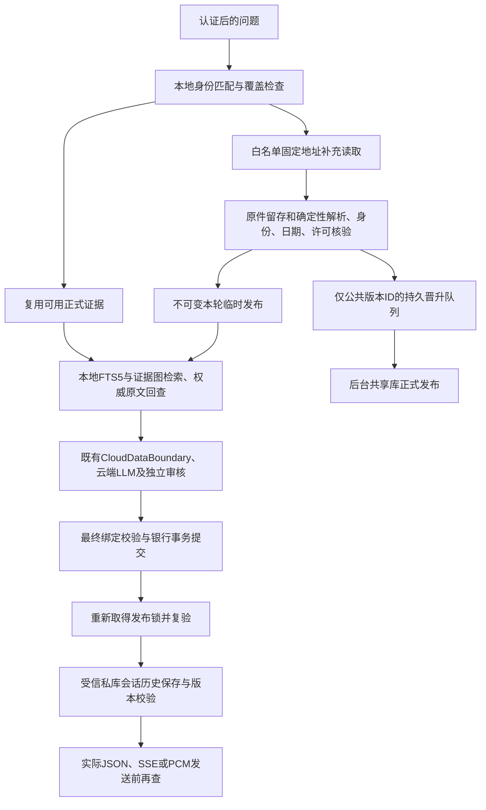

# Navren 公共证据补充运行时实施与验收

> 历史设计或实施记录：保留文内注明版本的测试结论，不能作为当前版本的验收结果。当前实现与运行方式见 [README](../README.md) 和 [技术说明](../TECHNICAL.md)。本机机器信息已清理，未发布的历史产物不提供仓库链接。

本次落实的是“本地核验并固定本轮证据，再交给云端模型；共享库正式发布异步完成”。它不把模型生成的回答当作金融原件，也不以完成入库、HTTP 200 或审核模型批准证明金融结论正确。现役 18767 未重启，测试使用隔离副本、数据库和临时端口。

最新接线增量见 提交后异常与真实慢客户端验收（历史资料未随仓库发布）。最新冻结的 97 项检查全部通过，真实外层与子进程退出均为 0；下文 `offline-07` 的 191 项和 `implementation-summary.json` 是此前版本的证据，保留原件，不推广到新源码或整个当前工作树。真实云端联合验收仍未完成。

## 已实现的路径



`local_knowledge` 使用独立 SQLite：来源许可、产品/份额/渠道身份、原始文件、文档版本、定位片段、FTS5、证据图、发布成员和冲突均可回查。新增的 `evidence_promotions` 保存公共版本 ID、状态、重试时间和受控错误，不保存问题、个人条件或工作区 ID。个人历史、记忆和组件仍进入基座的加密私库；银行账本继续独立。

本轮 `RoundProvider` 固定发布 ID，包括空库状态；后台切换正式发布不会替换正在回答的证据。公开身份词典读取也加入引用摘要，避免新产品名先发给模型、后来才发现来源撤回。目录工具只返回当前选中的最多 12 个对象，明确选择范围、可验证的目录总数和截断；缺总数时保留未知，不能把选中数量写成全行产品总数。

原件准入检查包括固定端点、结构和类型、重复键、日期、哈希、精确片段、产品代码及渠道。仅官方微众目录的确定性字段允许自动准入；其他 PDF、新语义、完整费率解释和底层份额映射继续按候选审核流程处理。字段不能跨来源混合。已审核版本的再次准入幂等；旧发布日期不能覆盖新版本，同日不同原件也不能自动成为修订。主动撤回的新版本不会自动恢复旧版本。

## 更新、资源与覆盖边界

冷请求先做本地匹配，来源端只收到固定官方 URL，不收到用户问题或私人条件。普通不相关提问不触发采集。冷读取设置超时，合并并发读取，超时后到达的结果不能继续准入。公共原件缓存 300 秒，失败缓存 30 秒；已有正式字段满足请求时走本地热路径。晋升队列最多 64 个待处理任务，单后台 worker 每批处理 16 项，支持去重及重启恢复。

时效按字段而不是一律高频刷新：当前微众适配器的一般披露、风险、费用、投资者字段最多使用 7 天，销售状态仅披露当日；销售披露仍不能证明即时可申购。来源日期使用上海自然日。比较中第二个对象或所问维度未覆盖时继续补充，仍不足则明确缺项或追问。

真实官方读取记录在 `outputs/evidence-runtime-20261006/official-01/results.json`。本次返回 13,658 条记录，但来源日期为 **2026-09-24**，当次核验未准入任何当前字段，也未发布。网络取得成功不能替代时效检查。没有凭此补造现售状态、收益率或持有数量。

当前已有 5,000 片段与单轮 12 对象的边界；临时发布的保留清理、大规模用户负载、跨进程会话互斥和长期队列治理尚无生产验收依据。资料不足时返回缺口，不能声称任意金融问题都能自动补全。云端沿用现有允许字段投影和别名策略；“公开采集不发送私人问题、共享库不保存个人资料”不等于所有金融派生字段都禁止出站，银行部署仍需明确敏感字段策略。

## 消费端与最终发布

`EvidenceGuardedClient` 在主模型与审核模型两侧追加同一固定证据范围提示。预算估算、协议正文生成、序列化和实际发送使用同一变换；提示不能在估算后偷偷增加，也不能在发送前调高已分配预算。真实 Native/GLM 本地传输测试检查 exact wire、上限减一时 attempts=0、无密钥读取和无网络发送。

`MetricEvidenceObserver` 只登记可信金融服务实际发行的本轮批次，准备操作不能让模型提交一组自造批次。真实 HTTP 已验证现金流读取→产品读取→准备操作→独立审核→最终绑定，资金仍未执行。A/B/C 的 gateway 入口仅只读转调基座适配器；其方法数据质量和独立正式验收归原 owner，不能据此称当前收益或完整资产配置已具备。

最终响应采用两阶段。第一阶段按 bank→market→knowledge→rules 锁序验证并绑定，外层公开/规则锁覆盖真实银行提交；提交失败不得进入成功发送。第二阶段重新按同一顺序获取只读银行发布区，复查相同快照和版本。发布区禁止银行写入，退出回滚空事务，不依赖发送后的业务提交。

Agent 的 `finalize_result` 保持原工作区锁，历史写入只通过基座 `save_turn_guarded(..., bank_db=...)`，复用已持有的银行连接，不再次启动银行写事务。最新基座兼容接口按原会话历史合同保存，长期记忆开关不充当聊天保存开关；处理中关闭、修改或删除造成版本变化的旧轮仍被拒。旧关闭记忆即跳过历史的候选已保留，不能作为当前语义。JSON/SSE 编码后首个实际发送检查点才触发历史处理，正文、组件和语音快照切断可变别名。

每次实际 socket 发送前后复验，单次分段最多 65,536 字节；语音每帧还核验凭据时限。Agent 提供原轮 `assert_budget` 和 `remaining_seconds` 闭包；发布复验沿用原截止时间，实际写入 timeout 取 2 秒、原剩余时间及已有 socket timeout 的最小值，不新建时间预算。普通流保持原 socket 超时。锁等待仍可能消耗额外时间，取得锁后按原时钟拒绝，不能把这一实现称为整个 worker 的 105 秒硬终止。

私库写入可能已经提交，再因文件权限设置抛出异常。最新 server 在真正调用可信历史 writer 前记录 `history_attempted`，异常后仍按本请求 ID 和原件 CAS 补偿；预算检查先拒绝而未调用 writer 时保持未尝试。真实 HTTP 已验证提交后的权限异常发生、成功正文未发布、此前非空历史和组件恢复、私库及银行审计均记撤回。新慢客户端用例在发送时限读取前只平移一次原轮时钟，以真实 TCP 小缓冲及不读取客户端触发实际 `TimeoutError`，断言停止后续帧并撤回历史和语音凭据；不将这项测试写成端到端时延保证。

发布开始后任意复验或传输异常均终止连接，不追加第二个成功/失败结果，不被 SSE 的普通断网兼容逻辑吞掉。清理异常也不覆盖原发布异常以触发补发。已经进入传输的有效前缀不能追回；后续片段停止发送。本轮语音凭据被撤销；未执行的本请求 Agent 草案取消；历史按响应 ID、版本及密文原件 CAS 补偿，在工作区锁释放前处理。其他轮次、用户后续修改和已执行交易不能被清理动作覆盖。撤回返回与本地银行审计区分 `discarded`、`partial_or_stale`、`unavailable`、`error`；没有匹配原件或后续记录已变化时不声称完整撤回。审计只留本轮随机 ID、阶段、受控错误代码和计数/状态，不存正文、语音 token 或异常原文。

基座历史接口见 `outputs/window-progress/base/guarded-history/interface.md`，原 26 项检查只绑定旧候选；最新会话兼容变更另见 `outputs/window-progress/base/session-history-compat`。两库和网络不是原子提交；CAS 拒绝时不能报告完整历史撤回。实际部分发送、临近原截止时限与清理异常均有隔离 HTTP/SSE 回归；慢客户端规模、跨进程锁和现场部署仍需联合验收，不能仅凭局部网络例宣布银行生产可用。

## 检索性能证据

`outputs/evidence-runtime-20261006/resolver-benchmark.json` 保留九组规模、每组三次的合成基准。5,000 个发布成员、32 个引用时，批量索引回查中位数 184.537 ms，同等检查的全扫批量回查 299.246 ms，逐个全扫 3,591.408 ms。保留完整成员清单封存与原文/许可/身份/图检查；没有缓存正文来跳过撤回门。

这些数字来自单进程暖缓存及当时 Mac 负载，只说明引用回查这一步的测量。完整清单仍为 O(N)，候选检索和部分图路径仍可能扫描正文；不能据此宣称整轮延迟、并发容量、API 成本或图检索质量改善。旧题集图检索与 FTS 均 12/12，尚未证明图检索增益。

## 验收记录与未通过项

原冻结验收结果见 `outputs/evidence-runtime-20261006/implementation-summary.json`，包含实际进程退出码、代码/输入 SHA、测试计数和测试日志。`offline-07` 的 191 项检查全部通过，实际退出 0，364 个封存输入成员哈希未变化；候选测试会创建一个服务规则发布锁文件，该文件明确列为未封存运行产物。最新 server 的提交后异常增量和 HTTP 测试生命周期修复另封存于 `postcommit-history/recheck-01`，额外慢 TCP 用例 v2 封存于 `recheck-02`；最新 32 个运行时、25 个真实 HTTP、32 个历史、7 个语音及 1 个慢 TCP 用例共 97 项全部通过，真实外层与子进程退出 0。两个此前失败的增量运行均保留，不覆盖为成功。工作树另有 UI、登录及集成脚本变化，不能将冻结成绩推广到整个当前站点。

`compatibility-final.json` 只读复跑 `offline-06` 的原模块，共 39 项（历史 32、语音 7），全部通过，真实子进程退出 0。这份记录对应当时冻结，当前 server 的新异常标记另由最新 97 项验证。公开客户端增补的本地拒绝零请求记账标记及真实供应商拒绝仍记已发送的反例均在 `offline-07` 内通过。`paid-protocol-probe.json` 使用真实 Native/GLM 序列化和预算、离线传输夹具，完成一次知识检索→终结→审核→临时快照与凭据复验；三个实际 wire 字节数均等于准入记录。它仍是零真实模型调用，不能代替供应商实测。

真实 `cloud-04` **未通过**：原 100,000 / 4,000 / 105 秒配置下，两次 DeepSeek 调用实际合计 18,152 tokens。首轮查目录和状态；次轮因完整探索/终结/审核保留预算不能共同容纳而只开放终结工具，模型仍请求未开放的 `knowledge_search`，被 `INVALID_FINAL_CONTRACT` 拒绝。没有 GLM 调用、获批正文或语音凭据。代码与输入封存未变化，真实退出 1；此问题已交 Agent 工具编排 owner，不通过加预算、删除条款或改验收题解决。本地事实库、临时证据和拒绝门完成不等于云端正常用例已验收。

Agent 此后已稳定交付公共工具视图与完整审核证据的无损去重，局部 67 项实际通过；旧失败只适用于旧封存，不作为新版本失败或通过依据。原权限、全部证据和预算不变，新的正式 G1/G2 由集成窗口独立运行；本轮没有同源付费重试。

离线脚本模型只证明协议与拒绝边界；云端单例仅为合成公开目录，不替代真实金融四题或 G2，也未执行真实云端 TTS 音频合成。现役 18767 仍未重启，本次交付不代表已发布到该进程。

失败记录保留：`offline-01` 因测试全局共享公共库及遗漏合成输入而失败，不能由管理器“产物落盘成功”改成测试通过；`cloud-01` 48,000 配置在实际用量 53,273 时触发预算失败；`cloud-02` 云协议通过但正文误称目录过期，其 WEBANK 规范 ID 查询匹配和空结果时效表达随后修正，不能作为语义通过证据；`cloud-03` 的 80,000 配置首轮即收尾，真实一次调用 5,494 tokens 后因继续索要工具被拒。旧 F11 回放中基座源码中途变更触发失效，旧 FG04 替身未到审核模型，同样不能记为当前原题通过。金融四题的 100,000 / 4,000 / 105 秒参数与原验收预期不被此单例替换。

独立 A/B/C 探针见 `method-wiring-probe.json`：真实入口和签名批次可用；缺数量/价格/现金边界的收益仍不可算。来源保留键覆盖、批次 A→B→A 与适配器锁序的旧风险已交基座，其修复与组件检查记录在 `outputs/window-progress/base/finance-method-wiring/verification-summary.json`。基座报告实际 Python 341 项、原 JavaScript 32 项通过；这是组件证据，金融比例消费、新工具全协议、G1/G2 与真实产品覆盖仍由联合验收确认，不能将旧探针漏洞继续描述为现版本未修，也不能称金融方法整链已通过。

复现命令使用新的输出目录，避免旧报告掩盖新失败：

```sh
# 在克隆后的 Navren 项目根目录执行
.venv/bin/python -B scripts/verify_evidence_runtime.py --mode offline --out /绝对路径/新目录
.venv/bin/python -B scripts/verify_evidence_runtime.py --mode cloud --out /绝对路径/另一个新目录
```

`--mode official` 只读取登记的固定来源并记录准入结果，不发布。启动服务本身不自动联网。云模式须显式选择；密钥由统一加载器从钥匙串提供，不写项目、日志或验收产物。
