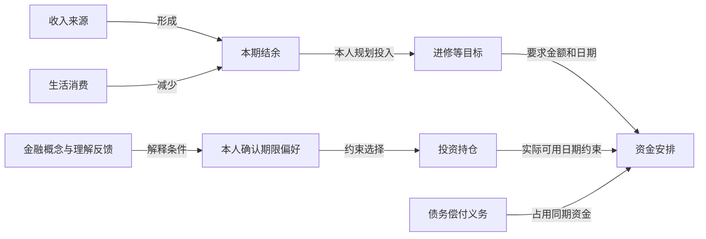

# Navren 四板块图谱与微众产品收益一体化落地方案

> 历史设计或实施记录：保留文内注明版本的测试结论，不能作为当前版本的验收结果。当前实现与运行方式见 [README](../README.md) 和 [技术说明](../TECHNICAL.md)。本机机器信息已清理，未发布的历史产物不提供仓库链接。

日期：2026-10-05。用途：交给另一窗口执行的最终实施合同。

本轮只交付方案，未修改应用代码、迁移用户数据库或完成全量行情采集。下文严格区分已核验事实、设计决定和实施验收要求。

执行目录：`项目根目录`。先读取当前 AGENTS.md、并发写入范围及最新代码，保留其他窗口的未提交改动。

**本文件是以下工作的统一执行入口：四板块个人财务知识图谱、微众代销产品与历史收益、财务日历改版、全产品小字与问号说明。**此前《Navren个人财务知识图谱重构方案.md》的五板块导航及旧实施顺序由本文件替代；此前日历改版方案的产品和收益设计按本文件合并执行，特别是第 6 节的核算口径。既有来源/时序/权限原则继续沿用。

不扩展本次范围到市场资讯重写、模型重新接入、云端发布或真实银行交易。沿用现有模型工作流、事件导入和业务确认能力；如集成验收暴露相关缺陷，明确记录并修复必要接口。

## 1. 最终结果与当前诊断

### 1.1 用户最终看到什么

“我的”图谱采用四个入口：**日常收支｜财富结构｜目标与责任｜偏好与认知**。默认提供四组关系的紧凑总览，点击进入相关子图；各组共用对象、证据与计算，跨组关系持续可查。

“账户”日历清楚显示每日投资损益、现金收支和生活事项。盈利、亏损、零值、未披露、不可计算均可区分；点击日期看到全部内容，点击产品看到可复算详情与官方原文。

当前有效模拟投资组合逐步切换为具备微众销售证据的真实产品。真实行情与模拟份额/交易各自标识，历史模拟组合可回放；用户可看到真实净值如何产生正负收益，而不是固定本金。

稳定概念说明进入标题旁问号浮层；重要状态、金额与业务确认条件继续直接可见。重复套话、无用小标题及内部时间戳清理到全产品。

### 1.2 目前不是单一“产品过期”问题

| 当前核验/诊断 | 实施处理 |
|---|---|
| 图谱一级混用了内容、分析问题、风险/时间维度及工具入口 | 重写四板块查询合同，不能只改六个标签文字 |
| 后端聚合收入，但旧资金洞察只为支出生成；默认裁图可能只保留支出路径 | 默认必须覆盖收入和消费两端，再聚合展开 |
| 持仓、债务、家庭责任和个人决策记忆缺少完整投影 | 补事实字段与跨组关系，数据缺失明确标记 |
| 微众公开产品目录日期仍为 2022-07-14 | 作为历史目录证据，不能改同步时间冒充当前在售 |
| 模拟产品主要按固定 1 元、本金口径生成；本机默认库此前观察到估值表为空 | 核实实际服务数据库，建立真实净值、历史份额、成本和交易链 |
| 日历隐藏未知收益，部分已计算的零收益也不显示 | 独立呈现可计算、零值、未披露、缺数据状态 |
| 历史估值依赖当前持仓、多数据集存在重复汇总风险 | 修复账户/组合版本键，按历史账本回放，选择唯一有效数据版本 |

直接检查的代码包括 `financial_graph.py`、`js/personal_graph.js`、`public_products.py`、`wealth_returns.py`、`financial_calendar.py`、`js/calendar_ui.js`、`simulated_bank/generate_fixture.py`。代码仍可能由其他窗口更新，实施前重新确认。

本机默认数据库观察不证明截图服务使用同一数据库。首次执行记录实际服务地址、数据库路径、工作区、业务日期、产品/持仓/订单/估值数量，再做备份。

## 2. 四板块的完整产品合同

### 2.1 一级划分与核心联系

| 入口与建议内部标识 | 内容 | 核心联系 | 默认结果 |
|---|---|---|---|
| 日常收支 `cashflow` | 收入来源、消费、固定开销、退款、融资费用及变化 | **本期结余** | 收入与消费两端同时可见，解释结余怎样形成 |
| 财富结构 `wealth` | 现金、存款、投资、应收、贷款和信用卡债务 | **净资产与可用条件** | 资产和负债两端同时可见，解释财富组成及变化 |
| 目标与责任 `plans` | 个人目标、家庭责任、生活事件、保障安排和既定义务 | **资金安排** | 金额、期限、优先级与可用资源形成支持/约束路径 |
| 偏好与认知 `preferences` | 生活价值、期限/风险偏好、金融兴趣、理解反馈、历史选择 | **选择依据** | 解释某项偏好或认知怎样影响具体规划和选择 |

总览可使用 `overview` 作为页面状态，不是第五个内容板块。“资料查找/证据查看”是工具；成本、风险、未来周转、变化与取舍是跨组分析视角。

上述四个连接词对应计算或经确认的关系，不能做成四个大圆圈再挂资料标签。每条线有明确动词、金额/条件、时间与证据。

### 2.2 日常收支

默认子图：收入来源→收入事件→本期结余←消费类别/费用；可展开到账账户、商户、退款和相关合同。收入、支出都必须进入默认视图，不能只显示金额最大的支出。

主指标：已记录日常收入、净消费及生活/融资费用、日常结余。账户净现金流单列，可展开融资、本金申赎、投资分红与内部转账等解释；投资客户交易费在投资损益中核算，不重复并入同一日常结余。

首版“日常结余”采用明确的生活收支口径：已确认劳动/经营/补助等日常收入，减当期记录的消费和经济费用；退款按到账期间抵减对应类别并保留原单联系。投资回报在财富结构单列，已到账投资分红可在现金记录中查到，但不再次并入同一日常结余。

信用卡消费按购买事件计入消费，后续本金还款不再计一次消费；借款到账不算收入，理财本金买入不算消费。需重述原消费期间时以独立口径/版本呈现，不能悄悄改历史。

收入来源未知时显示“未分类入账”，不得自动猜成工资。未知、不完整账户与完整月份区别显示；已记录收入为零不等于用户没有收入。

### 2.3 财富结构

默认子图为资产与负债两侧：账户/持仓/应收→已覆盖资产；贷款/卡债→已覆盖负债；两者形成同币种、指定时点的已覆盖净资产。投资进一步连接统一产品、份额、真实净值、成本、损益、结算和可用条件。

主指标：已覆盖资产、已覆盖负债、已覆盖净资产、可用现金、投资损益。覆盖不完整时禁止把已覆盖净资产写成用户全部财富。

默认估值使用截至所选时点最近合格披露值，详情列出各产品净值日；旧价格可用于有时点说明的最近估值，不能制造新一天的零收益。不完整估值显示已核验部分及缺项，完整组合结果保持不可计算。

银行余额、投资市值、未结算权益和应收不能重复计入。保障额度、授信额度、目标金额和规划分配不是资产；贷款本金不是消费。

净资产是时点存量，结余是期间结果，不能相加。净资产变化需区分经营/生活结余、投资损益、其他财富变化与覆盖变化，不能直接等同于结余。

### 2.4 目标与责任

默认子图：目标/已确认责任→金额与期限→资金安排→现金或可用资产；不满足条件时展开缺口或期限冲突。

个人目标、家庭责任、法定/合同义务各自保持类型。家人生日是生活事件，礼物预算是计划，购买礼物是交易，不能合成一笔已发生支出。

生活事件包括本人确认的毕业、就业、迁居等；只连接有依据的收入、合同、资金需求及目标变化。家庭责任记录实际承担人、分担比例、有效期和依据，不能由转账次数猜亲属关系或责任，也不自动读取亲人的账户。

主指标：目标资金缺口、已确认规划分配、近期责任及可用日期冲突。目标 `saved_minor` 不等于某账户已预留资金，新增明确资源分配后才计算重复占用。

未来收入、产品解锁、赎回申请与实际到账分别建模。规划分配是计划；只有业务账本确认冻结/预留，才减少对应可用余额。规划冲突和现实负余额使用不同提示。

### 2.5 偏好与认知

默认子图：本人确认的偏好/知识关注→具体选择条件→相关目标、产品或生活安排。例：“尽量保持资金灵活”→期限条件→某产品锁定规则→临近家庭付款。

区分本人陈述、行为观察、产品兴趣、知识兴趣、理解反馈及正式风险测评。曾提问/阅读/购买不代表已理解、长期喜欢或适合购买；正式适当性校验不能由一般记忆替代。

记录完整决策链：证据→备选方案→用户取舍/拒绝原因→确认→实际执行→反馈或观察结果。建议、用户承诺和实际操作分别保存；没有执行证据显示“尚未核实”。

偏好有范围、有效时间、例外及修订。新偏好影响相关建议和子图，不改写原始交易；删除记忆后派生结果与索引失效，不能从历史图快照复活已删内容。

主指标不做“金融认知评分”。展示已确认选择条件、相关知识疑点及与当前安排的联系；有明确理解检查时保留方法和结果。

### 2.6 跨组关系和实际价值

保留下列跨组路径，金额只由程序和有依据的记录生成：



图中的规划投入必须有分配依据；没有来源追踪时只解释收入、支出共同决定结余，不能画“某笔工资具体支付了某杯咖啡”的确定资金流。

## 3. 图谱视觉、布局与交互

默认采用稳定二维布局，三维保留为可选探索。页面首先呈现四组紧凑概览和少量有依据的发现；进入板块先保证关键两端和完整路径，再聚合商户/交易，按需展开。

现有固定 12 节点限制改为渐进展开策略：数量控制服务于可读性，不能裁掉收入、负债、责任或必要证据节点。四个板块各自采用合适布局，不能继续用同一套类型分列硬套所有内容。

| 视觉元素 | 统一语义 | 实施边界 |
|---|---|---|
| 节点面积 | 当前同币种、同类口径的金额规模 | 半径按绝对金额平方根映射；精确值常驻或点击可查 |
| 节点颜色 | 对象类型 | 资金蓝、义务棕、目标绿、偏好/知识紫；配类型图标 |
| 状态边框/徽标 | 缺口、未核实、失效等明确状态 | 配文字，不能仅靠颜色判断 |
| 线宽 | 已量化的支付、持有、分配或贡献金额 | 同类关系统一尺度；非定量关系固定细线 |
| 箭头和动词 | 入账、减少、支持、分配、期限约束等 | 资金流与条件依赖在图例中区分 |
| 实线/虚线/点线 | 已发生、已确认未来计划、候选/情景 | 候选与情景另配状态标签，不能混淆 |

存量与流量分开给尺度，不能比较账户余额面积与月消费面积来推断占比。负值按绝对值定大小，同时保留符号；零值与未知不同。设置最小点击尺寸或上限时图例注明显示处理。

节点填充采用稳定类型色；投资收益数字/标记与日历统一为盈利暖红、亏损青绿、零值灰。不要用盈利色评价消费好坏。

偏好与认知默认固定大小，用本人确认优先级和具体关系表达差异；不以提及次数、语义相似度或模型分数当财务强度。

点击节点查看对象事实与相关路径；点击线查看定义、金额、期间/时点、来源与计算。支持查找、回到总览、筛选来源/期间、与 Navren 对话。手机以紧凑图加路径列表承接，键盘可访问，选中对象刷新后尽量稳定。

拖动或编辑图形不直接执行转账、赎回、代扣解除等操作。规划修改复用本人确认；真实业务动作复用现有准备、规则审查及确认边界。

## 4. 微众产品与官方历史数据接入

### 4.1 已核验来源与边界

2026-10-05 只读复核结果：

| 官方来源 | 已观察结果 | 可用范围 |
|---|---|---|
| [微众产品目录 JSON](https://www.webank.com/data/product.json)、[查询页](https://www.webank.com/mobile/prod_query.html) | HTTP 200；1,145 项；`ret_data.date=2022-07-14` | 历史目录证据；旧“在售/存续”不是今天的渠道状态 |
| [东方基金新增微众销售公告，2025-05-14](https://www.orient-fund.com/upload/pdf/1747116276433-gyzjszqhwzyxgfyxgswgsqxbfjjxsjgdgg.pdf) | 明确 2025-05-15 开通所列基金的相关销售业务，含下列三个候选 | 证明历史销售关系；当前微众仍可申购未核验 |
| [东方基金新增微众销售公告，2025-12-12](https://www.orient-fund.com/upload/pdf/1765416718651-gyzjszqhwzyxgfyxgswgsqxbfjjxsjgdgg.pdf) | 较新的产品及滚动持有规则 | 扩展候选线索，行情与渠道现状另核验 |
| 东方基金历史净值网页 JSON | 三只候选首末页共六次请求均 HTTP 200，返回份额代码、日期、单位/累计净值 | 管理人网页使用的未文档化端点；不是微众开放 API |

微众是销售机构，东方基金是管理人。页面写“微众银行代销的××基金”，分别展示两家机构；不能宣称微众发行这些基金或已接通真实客户账户。

本次未验证面向公众、有文档及服务承诺的微众财富 API。未文档化网页端点的访问成功也不是稳定性或批量再展示授权承诺；实施前核查公开使用范围，保留缓存和源故障处理。

### 4.2 首批数据候选

| 份额代码与产品 | 管理人官方详情 | 已实际读取的首页面数据 |
|---|---|---|
| 006210 东方臻宝纯债 A | [详情](https://www.orient-fund.com/products/zhaiquan/006210/index.html) | [历史净值](https://www.orient-fund.com/chart-web/chart/fundnettable!getFundNetTableJson?fundcode=006210&from=2025-09-01&to=2026-09-30&pages=1-6) |
| 001198 东方惠新灵活配置混合 A | [详情](https://www.orient-fund.com/products/hunhe/001198/index.html) | [历史净值](https://www.orient-fund.com/chart-web/chart/fundnettable!getFundNetTableJson?fundcode=001198&from=2025-09-01&to=2026-09-30&pages=1-6) |
| 021095 东方低碳经济混合 C | [详情](https://www.orient-fund.com/products/hunhe/021095/index.html) | [历史净值](https://www.orient-fund.com/chart-web/chart/fundnettable!getFundNetTableJson?fundcode=021095&from=2025-09-01&to=2026-09-30&pages=1-6) |

同一查询区间为 2025-09-01～2026-09-30，每只返回 44 页；`pages=1-6` 为第一页、每页 6 条，`pages=44-6` 为末页、返回 5 条。首末页分别覆盖到 2026-09-30 与 2025-09-01，每只实际只核验了 11 条。

**中间 42 页及分红/拆分完整性尚未验证；不得把首末页可读写成完整历史已接通。**产品页静态净值为 `--`，要读取其实际网页数据，不能把页面骨架当行情。

数据端点与参数：

```text
https://www.orient-fund.com/chart-web/chart/fundnettable!getFundNetTableJson
fundcode=006210 或 001198 或 021095
from=2025-09-01
to=2026-09-30
pages=1-6
```

候选用于数据验证，不是给用户的投资推荐。风险等级、申赎、持有期、限额和费用必须取自适用官方资料；不能按“纯债/混合”等名称猜 R1/R2，也不能把所有模拟客户分配同一种风险。

南方现金通 E（000719）此前未取得连续官方万份收益；暂不列为已接通产品。货币基金只有获得日万份收益与结转规则后加入，不能用七日年化除以 365 填日历。

### 4.3 分开保存三类状态

每个份额独立保存：

1. 销售证据：机构、公告日期、生效日、历史有效范围、当前渠道核验状态。
2. 产品状态和条款：成立/终止、开放/暂停、持有和结算规则、风险与费用、生效版本。
3. 行情状态：净值日、公布时间、有效数据区间、缺项、源故障和修订。

目录旧、产品终止、暂停申购、暂无新净值不能混为“过期”。管理人直销开放不能证明微众渠道开放。历史销售证据可支持标识清楚的历史模拟；当前申购所需渠道/规则未核实的，不放行对应新申购。

## 5. 统一事实底座与历史采集

### 5.1 一个对象、多个视角

沿用 SQLite 业务账本和可重建的图投影；现有规模不要求先引入 Neo4j、图神经网络或让模型生成财务事实。

产品、交易、持仓、合同、责任、事件、目标、偏好和知识记录各有稳定 ID。四板块、日历、账户、推荐、聊天引用同一对象 ID 和有效版本。

| 数据职责 | 必要信息 |
|---|---|
| 产品身份/销售证据/条款 | 管理人、注册/产品标识、份额代码、微众证据、适用时间、条款版本 |
| 行情与企业行为 | 单位/累计净值、日期/公布时间、分红/拆分、原始精度、来源修订 |
| 模拟持仓和交易批次 | 申请/确认/结算日期、净值、份额、成本、费用、分红方式、交易状态 |
| 权益与现金结算 | 分红/赎回应收、待确认申购权益、投资单元现金、实际到账及关联事件 |
| 组合版本与转换 | 期初、版本身份、迁移映射、资金守恒、活动版本选择 |
| 图实体/关系/分析 | 类型、来源、有效时间、记录时间、完整输入、方法版本及状态 |
| 目标/责任/记忆 | 资源分配、金额和期限、本人确认、适用范围、修改/删除及决策反馈 |

复用现有表；需要新增时通过迁移脚本和约束实现。图谱关系不是原始账本的替代品，不能把全部语义塞进无约束文本字段。

每条关系或结果至少带工作区、来源范围、对象/记录版本、金额/币种或单位、期间/时点、证据引用、生成方式、方法版本、状态、覆盖与假设。有效时间与系统获知/修订时间分开；情景单独标识。

身份与权限取自可信服务端会话。每个用户的个人事实、记忆与证据隔离；公共金融概念可共享，私有关系不能跨用户检索。本机模拟工作区不等于生产级多用户授权。

导入账单、模拟银行与公开市场资料分别保存来源。公开真实净值可用于模拟估值，但不能把模拟合同/家庭资料静默拼入导入的用户真实财务图。

### 5.2 采集和版本策略

行情唯一键包含管理人/注册标识/份额代码/净值日期；同日修订保留版本，并选择一个有效版本。估值唯一键至少包含工作区、账户、投资单元/组合版本、份额代码与估值日。

采集逐页校验 `currentPage/totalPage/dataList`、返回份额代码、日期范围和精度；不写死 44 页。原始响应保留获取时间、来源 URL、内容摘要及适配器版本。

`rate=-999999.99` 等占位值转缺失；禁止直接作为收益。A/C 类不能混用；数据修订按完整键覆盖有效版本，重复采集不新增重复估值。

获取分红、拆分和条款资料后，核验每只基金实际应披露日与可用区间。非披露日不算丢失；未知覆盖不能当完整。目标约 12 个月，首版先交付可复算 90 天链和至少一个完整月份，以实际产品成立/渠道销售时间与数据为准。

使用有限超时、有限重试、低并发、缓存和增量采集；源失败保留最近合格历史。执行长采集须报告真实进度、失败页与预期文件，不只报告程序启动或 HTTP 200。

发布 `source_probe.json` 与 `history_coverage.json`：实际取得的页/行、日期、去重前后数量、缺失/修订、企业行为、费用条款及渠道状态；只证明实际核验过的内容。

### 5.3 时间与来源共同合同

分别保留现实今天、模拟业务日期、统计期间、估值日、净值公布时间、交易确认与结算日期。界面默认遵循已有业务日期，不能为收益好看改业务时钟。

跨页面至少传递 `workspace/source_scope/portfolio_version/period_or_as_of/currency/method_version`。历史组合不能引用当前银行现金和合同伪造历史完整净资产。

## 6. 收益计算：采用统一权益口径

### 6.1 主口径与兼容口径互斥

新历史链采用 `total_equity_v2`：以明确边界的投资单元计算权益和外部资金流。

```text
E = 已确认份额市值
    + 已确认分红应收 + 赎回应收
    + 已扣款但未确认份额的申购/再投权益
    + 投资单元内现金 − 投资应付款及费用负债

F = 所有者资本投入 − 所有者资本提取（含向所有者分配的分红）

当日投资损益 = 期末 E − 期初 E − F
```

每一金额在权益组成中只出现一次。现金扣款、权益确认、应收与结算要用事件链平衡，不能同时保留扣款前现金与扣款后申购权益。基金净值已包含的运作费不重复扣；客户费用若已降低权益或形成应付，也不额外扣第二遍。

F 必须由账本按所有者投入/提取事件识别，不能把所有跨边界付款都算成提取。交易费支付、投资应付款结清等不属于所有者资本提取，费用损失应保留在损益内。例如期初 E=100、支付费用 1 后 E=99、F=0，损益为 -1；不能把费用记成 F=-1 抵消损失。所有者从单元外代付费用时，以费用负债和所有者代付投入结转，权益与 F 同步对账，仍只确认一次费用。

投资单元与所有者银行现金之间的资本划款可以计入 F；单元内应收到现金、红利再投和内部买卖只是转换。投资组合合并时内部跨产品转移抵消；家庭资产范围若已包含银行现金，同一银行现金→投资转换不再是家庭所有者资本流。对产品、组合和全财富三种边界分别定义，不能套用同一 F。

现有 `wealth_returns.calculate()` 只估值已确认份额，作为明示 `holdings_only_v1` 的兼容算法：

```text
损益 = 期末份额市值 − 期初份额市值
       − 确认申购对价 + 确认赎回对价 + 确认分红 − 另列交易费
```

该路径的申赎、分红按权益确认日期；再投计内部申购对价，分红权益只确认一次。**一旦采用含应收的 E，禁止再额外加分红或赎回对价。**请求/记录必须有 `accounting_basis`，不能根据字段是否存在自动猜算法；聚合前统一到可比较口径。

### 6.2 数字、完整性与损益分类

金额用整数分，份额和净值保留 Decimal 原始精度。按产品规定确认/舍入，保留份额尾差。展示汇总默认对逐产品分值求和，与明细对账；高精度过程及舍入差留在计算详情，不混用规则。

净值、权益状态、交易、分红/拆分和费用完整性分别校验；一个 `movements_complete=True` 不代表所有来源已齐。零份额且状态已确认时市值可以为零，不能给非零持仓用零净值补缺。

单位净值用于份额估值；累计净值用于历史核对，不能用其简单比值冒充客户回报。无完整份额/交易时仅展示产品净值曲线或明确假设的净值变动贡献，不写成客户净收益。

已实现、未实现、累计损益有固定成本方法与费用分配。旧函数的 `sale_minor−allocated_sale_cost_minor` 尚未扣另列交易费，须明确命名或补费用分配。建议成本不含另列客户交易费，费用单独追踪；红利再投资成本与分红确认一致，不能在成本和累计费用重复扣除。

跨日变动注明覆盖区间。周末/假日无新披露时显示最近估值和待披露状态，不前向填成当天零收益，不插值捏造每日数据。

现金到账由结算账本独立投影，即使该产品净值缺失，已核实现金到账也不能一起隐藏。应收属于财富，尚未到账不直接成为可用现金。

### 6.3 必须通过的收益样例

下列为构造案例，不是客户真实结果；均忽略未列费用，精度按明确规则处理。

| 场景 | 正确结果 |
|---|---|
| 100 份×1 元，除息后 100 份×0.9 元，确认分红应收 10 元 | E=90+10=100，损益 0；到账结转不能再新增收益 |
| 上述 10 元同日按 0.9 再投 | 新增约 11.111111 份，E 约 100，损益 0；内部再投不是新外部投入 |
| 次日才再投，次日净值升至 0.92 | 旧份额价值 92，加待再投权益 10，E=102；当日收益 2，结转不重复确认分红 |
| 期初市值 100，次日净值上涨后全赎回，确认赎回应收 105、尚未到账 | E=105，损益 5，可用现金仍为 0；随后向外到账 E 从 105 到 0、F=-105，该日损益 0 |
| 当日外部投入 10，先为待申购权益，之后确认份额 | E 增加 10、F=10，确认转换不产生收益 |
| 客户单独交易费 1 元降低权益，期初 E=100、期末 E=99 | F=0，损益 -1，只计一次；费用不是资本提取，净值中的运作费不另扣 |
| 同日多账户持有同基金，行情重采两次 | 各账户按各自份额计一次，组合只汇总有效估值，不能重采翻倍 |
| 当前已无该基金持仓，查询以前月份 | 历史估值与损益继续可查 |

官方 006210 此前核验的单位净值样例：2026-09-28 为 3.6844、09-29 为 3.6874、09-30 为 3.6834。连续 1,000 份、无交易/分红/另列费用时，两次净值贡献分别 +3.00 元、-4.00 元。实施者重取原文并核验事件后，将其用于日历颜色与复算验收。

## 7. 全部模拟投资产品的迁移

### 7.1 范围与产品适配

替换各模拟工作区的当前有效投资产品及对应持仓/业务版本。银行现金、普通存款、贷款、信用卡和用户导入的原始记录保持其真实类型，不强制换成基金。

先生成全部工作区、旧产品、持仓、批次、挂起订单及风险/期限场景清单。每个旧投资场景映射到合格微众候选；需要时扩展官方候选池，不把首批三只硬套给所有客户。

符合条件：份额身份唯一、微众销售证据、适用风险和条款、历史数据及企业行为、可复算费用/确认/结算。当前渠道未知的候选只在明确的历史模拟/研究范围使用；新申购按已核验现状决定。

没有合适产品或数据时列明具体缺口并保留可恢复旧版本，继续补候选；不得宣布全量完成。模拟费用可有明确假设，但不能冒充微众实际费率优惠。

### 7.2 版本转换与历史回放

1. 建立备份、版本号、迁移前现金/权益/成本/份额/订单快照。
2. 默认采用明确切换日的**模拟组合版本转换**：以旧组合可核验权益为转换资金，按新组合基准净值建立期初份额、成本和残余现金；转换前后资产守恒。
3. 迁移事件不冒充真实赎回成交，不产生虚构客户收益或历史买入。旧记录不改名字/外键套到新基金；同一时点只选一个有效组合版本。
4. 如选择按规则模拟赎回再申购，则锁定、费用、结算和确认完整执行，未结算资金不能提前成为新份额。挂起订单在旧版本完成或失效后重新准备，不能沿用旧确认执行新产品。
5. 为历史体验建立**独立的重建历史模拟组合**：从合格行情/条款起点生成有资金来源的期初、交易、分红与结算，逐日回放。不能反推原批次缺失的买入日，不能冒充原用户历史。
6. 当前转换组合与历史演示组合身份常驻可见，收益曲线不跨切换日硬拼。历史日历只聚合该历史组合与真实覆盖的同期事件；当前余额/合同不能充当历史余额/合同。
7. 完成按工作区对账、旧订单处置、恢复演练与所有页面一致性后切换默认。

版本转换验收例：旧组合权益 100 元→新份额市值 99.99 元+残余现金 0.01 元，转换本身损益 0；不能旧新同时汇总成 200 元。

迁移覆盖至少包括产品条款/文档、持仓、批次、分红/赎回应收、订单、建议、审计、日历与图谱快照。备份恢复需要覆盖数据库与活动版本配置，不只恢复单张持仓表。

## 8. 财务日历与完整详情

### 8.1 主布局

沿用 Navren 浅色体系，桌面七列、手机紧凑网格。顶部一行：**财务日历 [?]**、月份切换、时间视图、新建主按钮；导入、提醒和高级筛选放入更多菜单。

第二层：**总览｜收益｜收支｜生活**。来源、币种和当前组合用紧凑筛选；月/周/日/待办是时间视图，不堆成十几个同权重按钮。

主指标卡：本月投资损益、截至所选日持有损益、本月净现金流。持有损益与累计组合损益含义分别说明，不能把现金流加到投资收益里。缺项显示覆盖状态和已核验部分，不呈现伪完整数字。

常驻紧凑标识：“基于真实行情的模拟组合”“净值截至某日”；使用重建历史时直接显示“历史模拟组合”。版本 ID、毫秒时间戳和长方法说明进入详情。

收益视图首次展示最近完整且有合格估值的月份，明确历史期间并有“回到本月”；总览/生活默认按模拟业务日期，聊天指定期间优先。保存用户选择，不改变业务时钟。

### 8.2 日期格与颜色

日期在左上；日损益为主要数字；收支第二行；事项用标记和最多两条摘要，更多显示“+N 项”。金额样例：

```text
29                         ● 2 项
+3.00 元
收 6,000 / 支 120
```

盈利暖红、亏损青绿、零值灰，保留正负号及图例。浅底或细色带体现绝对金额强弱，默认使用本月统一尺度；跨月份比较可切统一尺度，并说明压缩/分档。

日期状态至少有：正收益、负收益、已计算零收益、未披露、缺数据。无新披露且累计权益变化跨多日时注明区间，不把整个变动伪装为单日收益。未来预算/计划不画成已赚收益。

收支用符号和文字，事件用图标；当天/选中日期用边框，不遮收益色。删除每格“暂无记录”，空事项留白，缺收益不留成无法判断的空白。

三种界面模式都能看清收益。手机保留日期、收益方向和金额，紧凑缩写后详情仍有精确值；不能仅通过隐藏收益适配手机。

### 8.3 点击后的全部信息

桌面右侧抽屉，手机底部面板或全屏详情；可关闭、Esc、焦点返回，支持键盘日期选择。

点击日期依次显示：

1. 当天投资损益、现金收支和计划状态，币种分别汇总。
2. 全部产品贡献：名称、份额代码、管理人、销售机构、损益、估值日与状态。
3. 全部收支：时间、账户、对手方、金额、类型、退款/本金/内部转账等语义。
4. 全部事项：金额/预算、付款或提醒日期、重复规则、状态、备注、关联目标/责任及动作。

点击产品查看：份额、净值及披露日、市值、应收/待确认权益、申赎、分红、费用、成本、已实现/未实现/累计损益、权益与外部流对账、历史曲线、算法口径、来源及修订。

长字段分组展开，所有当天项目可查到。官方来源直接打开对应详情/公告，不能跳机构首页替代具体原文。已全赎回产品也能查历史。

聊天日历卡复用相同收益与状态；查看完整日历保留月份、来源、组合版本。图谱点击收益或期限关系可跳日历对应日期，日历点击目标/责任可打开相应关系路径。

## 9. 全产品小字与问号浮层

| 处理 | 内容 |
|---|---|
| 常驻直接可见 | 模拟/历史身份、净值时点、缺项、未到账、渠道未知、当前关键状态及金额 |
| 标题旁问号 | 结余、净资产、收益、资金安排、尺寸/线宽等稳定概念和计算说明 |
| 分组详情 | 原始证据、完整字段、费用、修订、方法版本和技术诊断 |
| 删除或合并 | 重复口号、每格暂无记录、重复解释段、冗余 eyebrow、内部长时间戳 |

覆盖账户、推荐、我的、知识图谱、对话卡片与工作台。共用说明组件和文案登记表，逐页列出保留/折叠/删除结果，不能只处理日历。

问号为可点击按钮；浮层出现在附近，再次点击/外部点击/Esc 关闭。默认宽约 260—320px，边缘自动避让/翻转，手机空间不足改说明面板。先用一两句解释，更多内容链接详情。

按钮有“解释本月收益”等可访问名称和 `aria-expanded`，支持键盘及链接焦点；解释使用正常可读字号。不要仅悬停显示，不把小字搬进更小弹窗。原文和用户文本经安全 DOM 转义。

业务确认前的对象、金额、费用、实际影响、关键条件和必要风险直接可见；解释概念的问号不能遮掉用户作出确认需要的内容。真实错误原因仍可读并有对应恢复动作。

## 10. 接口、计算与模型边界

复用当前 `/personal-graph`、日历和银行服务入口，优先兼容迁移。新图查询支持 `cashflow/wealth/plans/preferences` 和总览状态；旧 `funds/cost/goals/liquidity/risk/records` 按功能兼容到新内容或跨组工具，更新前后端参数校验、知识映射、聊天上下文和持久化版本，不能只改标签。

统一返回合同建议包括：

```text
view, source_scope, workspace, portfolio_version, accounting_basis
period/as_of, nav_as_of, currency, data_version, method_version
metrics, subgraph, insights, evidence_refs
coverage, missing, assumptions, available_actions
```

字段随现有接口适配；计算、证据查询和渲染各自有职责。历史净值修订、交易补录、资料更正会使相关图/日历/聊天缓存失效。组合、日期或來源已变时拒绝旧动作上下文并重新准备。

模型负责找问题、选择有权限的子图与解释；实体匹配不确定时提出候选。金额、收益、资金缺口和日期由程序计算；独立审核不能凭语言判断证明数值正确。

知识记录→相关概念→官方材料可联动市场资讯，但无产品成分/合同依据不生成确定暴露关系或损失概率。认知兴趣不能覆盖风险、期限和业务规则。

## 11. 理论依据与设计边界

| 权威依据 | 直接支持的原则 | 本方案采用方式 |
|---|---|---|
| Hogan 等，2021，**Knowledge Graphs**，ACM Computing Surveys 54(4)，Article 71，[论文信息](https://arxiv.org/abs/2003.02320)，[DOI](https://doi.org/10.1145/3447772) | 有类型图数据、上下文、来源与质量校验 | 对象/关系有语义、时间和证据；分开事实、分析与候选 |
| Campbell，2006，**Household Finance**，The Journal of Finance 61(4)，1553–1604，[作者全文](https://campbell.scholars.harvard.edu/sites/g/files/omnuum5881/files/campbell/files/householdfinance_jof_2006.pdf) | 家庭金融连接目标、收入/人力资本、资产、流动性及借款约束 | 财务结构同时覆盖收支、财富、计划和人的选择条件 |
| W3C，2013，**PROV-O**，正式推荐标准，[规范](https://www.w3.org/TR/prov-o/) | 记录实体、处理活动、派生与修订来源 | 每条洞察可追溯原始输入、方法、责任和版本；派生关系不冒充因果 |

四板块是用户确认后的 Navren 产品设计，论文没有规定四个菜单，也不证明本作品已改善收益或金融福祉。费用、收益与申赎规则以具体产品资料及计算核验为依据。

理论支撑必须在验收文档映射到实际数据字段/规则与代表案例，不能只放论文标题作为背书。未来如加入统计偏好或风险模型，单列样本、校准和效果证据。

## 12. 实施顺序与文件职责

| 阶段 | 工作 | 必须先得到的产物 |
|---|---|---|
| A：现状与备份 | 实际数据库、版本/订单/持仓、四板块可用字段、官方源探测、并发范围 | 可恢复备份与现状清单，待补数据明确 |
| B：行情与权益 | 统一产品/条款、逐页历史、企业行为、`total_equity_v2`、历史估值键与版本 | 一个完整月份及 90 天目标链可复算，数值场景通过 |
| C：模拟迁移 | 风险/期限适配、当前组合转换、历史模拟回放、订单处置、全工作区对账 | 迁移清单、未覆盖项、资产守恒与恢复演练 |
| D：图谱与日历 | 四板块投影/查询/视觉、收益网格、日期/产品全详情、双向跳转 | 四组完整路径与真实净值模拟正负日历 |
| E：说明与联动 | 共用问号、全页小字、聊天对象/版本、手机及三种模式 | 页面文案表、跨入口数值一致及状态一致 |
| F：独立验收 | 数字/来源/权限/异常检查、用户理解任务及截图 | 逐项证据与已完成/未完成结论 |

建议涉及文件，执行前按最新代码确认：

- 产品与数据：`public_products.py`、`sync_products.py`、新管理人行情适配器、产品/条款/持仓/权益/组合版本迁移。
- 计算与投影：`wealth_returns.py`、`financial_calendar.py`、`financial_graph.py`、`finance_gateway.py`、现有现金流服务、`user_memory.py`。
- 页面与联动：`js/personal_graph.js`、`js/calendar_ui.js`、`js/calendar_client.js`、共用问号组件、`mine.html`、`account.html`、聊天卡片、`css/design.css`。
- 内容映射与校验：金融概念视图映射、图/日历/交易验收脚本和现有相关测试。

数据/收益、图谱/日历、说明/样式可分工；先定义共同接口，精确声明写入范围，同一共享文件只由一个集成人修改。只有准备就绪后做依赖工作，不并行修改迁移与正在使用的数据库。

首次交付必须覆盖四个内容组，不重新退回只交付支出/成本/周转三个视角。缺资料的组仍有明确对象范围、真实缺项与低负担补充入口，不用伪造节点填满。

## 13. 验收清单与交付物

### 13.1 图谱和口径

- 一级只有四个确认的内容入口；资料是工具，风险/时间等跨组使用。
- 日常收支同时有收入与消费；财富结构同时有资产与负债，不因裁图只显示一端。
- 期初现金 10,000，本期工资 6,000、消费 2,000、申购本金 1,000、借款到账 3,000，无收益费用：日常结余 4,000，期末现金 16,000、持仓 1,000、负债 3,000、净资产 14,000。申购不算消费、借款不算收入，净资产不加结余。
- 同一教育安排关联家庭、目标、日历与消费时只形成一次需求；同一资金重复规划有冲突提示，规划确认不改变银行余额。
- 偏好/知识连接具体条件与选择；兴趣不生成持仓或适当性，修正/删除后派生结果更新。
- 大小、颜色、线宽都有明确口径与图例；偏好不靠模型评分放大，存量/流量不共用误导尺度。

### 13.2 产品与收益

- 管理人、份额代码、微众销售证据和当前状态分别可查；2022 目录不伪刷新。
- 全分页、日期覆盖、缺失占位、分红/拆分与修订核验完成，HTTP 200 不等于完整。
- 第 6 节现金分红/再投/跨日/赎回应收/待申购/费用案例通过，两种算法不混算。
- 多账户、重复数据集、全部赎回和重新采集不会漏历史或重复金额。
- 原始来源、费用假设、净值日和模拟交易身份可查；完整与部分可用结果不同，零与缺失不同。
- 所有需迁移工作区有明确结果；迁移前后现金/份额/权益/成本/订单可对账、可恢复。无法适配仍列未完成项。

### 13.3 页面、解释与联动

- 日历至少一个完整有收益月份，实际可复算正、负、零/缺数据案例；桌面与手机金额可见。
- 点击日期可查全部事项/收支/产品，点击产品可查全部权益、收益和来源；不是只有摘要卡。
- 日历、财富图谱、账户、聊天的同版本同日期结果一致；历史模式不静默混入当前资料。
- 三种界面模式均验收；问号可点击、避让、键盘可用，关闭后焦点返回。
- 全产品完成文案登记，关键状态与确认条件仍直接可见，冗余文字清理有逐页记录。
- 模拟/导入、跨币种、账户缺失、旧上下文、权限、记忆删除、源不可用和数据修订场景有实际验证。

最终交付：

1. `设计文档/Navren四板块与产品收益实施验收.md`：逐项状态、代表截图、限制与未完成清单。
2. 源探测/历史覆盖报告、产品条款与销售证据映射、脱敏复算样本。
3. 迁移前后对账、活动版本及备份恢复方法，不能把私有用户数据写进 Git。
4. 桌面/手机/三种模式截图，全产品小字处理表，图例与解释文案。
5. 合适的现有回归及本次必要数字/迁移检查结果，至少一次浏览器→数据/工具→展示结果的完整核验。

验收完成才能宣称四板块与收益链路已落地；模型答复、页面能打开、采集程序启动和文件数量均不能代替上述结果。
