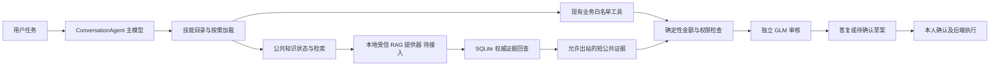

# Navren 技能体系实施与验收

实施日期：2026-10-05。正式代码位置：`/Users/manton/CC/projects/Navren`。

本轮把“诊断 → 目标规划 → 产品研究 → 资产配置 → 落实 → 投后复核”拆成应用内可按需加载的技能，并为另一个窗口正在建设的 RAG 建立消费接口。沿用 `ConversationAgent` 的主模型工具循环、独立 GLM 审核和现有业务后端，不另建一套账本。

## 已完成与当前边界

- 17 份主技能：16 份进入主 Agent 目录，1 份仅由独立审核链加载。包括 14 项专业能力，以及 banking 总入口、cashflow/wealth 两个旧兼容入口。
- 技能目录和原生工具的名称枚举读取同一份注册，新增技能不再需要手改第二份名称列表。目录只给任务说明和工具绑定，具体方法按需加载；10 份分支参考也按需读取。
- 新增 `knowledge_status`、`knowledge_search` 两个只读工具，默认没有公共知识提供器，明确返回未接入与证据缺口。允许后续 RAG 在本地注入受信提供器。
- 公共知识金额登记为 `public_minor_currency`，不能进入账户金额事实；检索答复必须经过独立审核。原文金额是否被偷换为个人资格/余额仍需审核语义，数字相同不证明同一含义。
- 技能加载不授予权限，也没有确认、执行、任意文件、任意 SQL 或私有索引选择接口。
- 没有改 RAG schema/数据库/索引、其他窗口页面、网关或常驻服务；真实端到端 RAG、真实渠道交易与收益序列优化仍未完成。

## 技能与自建/适配分工

| 能力 | 技能 | 方法来源与已绑定能力 |
|---|---|---|
| 知识检索与证据综合 | knowledge-retrieval | 适配上游检索策略与知识综合；接公共 RAG 状态/检索接口，未接入时明确缺口 |
| 财务诊断 | financial-diagnosis | 适配客户资料归一方法；个人资金、导入流水、负债保障和风险条件由 Navren 自建口径 |
| 目标与资金规划 | goal-planning | 原生；复用 budget/cashflow/graph_scenario/calendar_budget_scenario 精确计算 |
| 产品研究 | product-research | 适配检索与验证方法；产品本体、份额、渠道、费用、退出、收益口径由 Navren 维护 |
| 资产配置 | asset-allocation | 原生；先诊断和约束，当前产出有条件规划，尚无真实优化器求解 |
| 持仓与投后复核 | portfolio-review | 适配组合复核顺序；复用真实净值支持的独立历史权益核算，保留成本/交易/企业行为缺项 |
| 支付与收款 | payments | 原生；复用对象查询、单项草案、独立确认及原操作回执 |
| 订阅与代扣 | subscriptions | 原生新增；周期候选、商户合同与银行授权分别核对，两种取消互不替代 |
| 卡片与借贷保障档案 | cards | 原生；卡片草案可准备，贷款/保险只有已接入档案与流程说明 |
| 财务日历 | calendar | 原生；保留共享组件、日期规则、日历元数据草案与用户确认 |
| 个人条件与记忆 | profile | 原生；保留图谱四域、本人原话、开启状态、待核实与正式画像分离 |
| 银行服务条件 | bank-service | 原生新增；读取合成优惠规则，对话只有比较说明，工作台由本人预览确认申请 |
| 市场解释 | market | 原生；复用已核验原文、热点/周报、来源状态及现实时间，不推测组合收益 |
| 证据与用户利益审核 | reviewer | 适配数据验证方法；权限、资金、产品、配置、日历和用户利益规则由 Navren 自建 |

banking 负责理解任务和选择必要领域。cashflow、wealth 保留旧调用兼容，转入相关专业流程。用户只查余额时不要求测评；公开知识问题不读无关私人账户；单次复合任务按真实依赖逐项推进。

## 接入结构



私人原件和私人索引没有接入这两个公共知识工具。当前模型/语音可用云服务的部署方向不变；新接口不改变已有个人业务摘要出站路径。原件、引用、金额计算及出站许可检查仍属于本地受信后端职责。

## 技能运行合同

`agent_runtime/skills.py` 校验 YAML 名称与目录一致、角色、工具名格式、文件长度及参考文件范围。拒绝未知技能、绝对路径、跨目录参考及软链接。`metadata.tools` 只描述方法依赖，不会动态注册工具或赋予权限。

主 Agent 调用：

```python
load_skill(name='asset-allocation')
# 只有需要该分支时读取
load_skill(name='asset-allocation', reference='allocation-contract.md')
```

参考文件必须是该技能 `references` 目录中已登记的 Markdown 文件名。主 Agent 不能加载 reviewer；`GLMConversationReviewer` 仍从内部加载 reviewer 的完整必需规则。技能按任务选择，无需在一轮把所有父级、子级和参考都加载；现有默认上限仍为 8 轮、12 次工具调用，超出时安全结束。

## 与正在建设的 RAG 对接

接口实现：`agent_runtime/knowledge_retrieval.py`。本轮不直接读取那个窗口的 schema 空库，也不从测试标志推断检索已经可用。

由本地应用给 gateway 注入 `knowledge_provider`。模型没有配置提供器、scope、连接参数或路径的工具。提供器实现 `PublicKnowledgeProvider` 版本 1：

| 方法 | 必需输出/职责 |
|---|---|
| status() | schema_version=1、ready、provider_id、public_release_id；只能在实际发布可用时 ready |
| search_public(request, release_id) | 固定 scope=public 与发布 ID；返回 citation_ids、coverage_gaps，不直接使用向量正文载荷 |
| resolve_public_evidence(citation_id, release_id, as_of) | 回 SQLite 等权威记录检查发布成员、身份、原件/解析、当前来源撤回与许可；返回完整 canonical 公共证据或 None |

canonical 必需包含：citation_id、release_id、document_id、document_version_id、parse_id、span_id、标题/发布方/公开原文 URL、完整短 excerpt、页或段落及字符定位、产品/份额/渠道、发布日期/采集日/效期、条件、分析维度，以及 public、允许出站、未撤回、full_text 的许可状态。具体 Python 结构与样例见接口文件及合同测试。

消费端落实：

- 一次 BankTools 请求中的首次有效检索固定提供器与发布，后续查询不混代次。公共日期默认现实上海日期，不能沿用模拟银行日期。
- 每条向量/词法候选重新回查权威证据。不同产品、份额、渠道、版本、未生效/过期、私有、禁止出站、撤回和 metadata_only 都不能成为条款正文。
- 每次最多 8 条；excerpt 最多 1200 字符且定位区间与片段长度一致，超长拒绝，不能截掉条件后仍称完整。
- 输出字段白名单；不透传原件路径、任意 payload、全文或提供器报错私信。检索分数不当作事实概率。
- 效期缺边界保留 unknown，条款检索本身的 sale_status 固定 unknown，不能据此认为渠道当前可申购。
- 每次后续工具调用与终结展示前再次核对已经提供的引用；来源撤回、许可/正文变更或提供器不可用使旧证据失效。GLM 已批准也不能保留失效引用。
- 同一引用、同一查询日期的再次命中必须与首次完整投影一致；若检索内部发生版本、正文、定位、主体、效期或条件修订，拒绝沿用本轮证据，保留首次快照，不能用新快照覆盖旧证据的失效检查。不同查询日期分别保存并回查；正常同投影重复查询仍可用。

提供器仍必须真实实现身份映射、权限、原文逐字核验和发布检查；消费端合同验证不能替代这些事实工作。现阶段只有合成提供器用于测试，正式 gateway 没有连接真实 RAG 提供器。

## 开源来源与维护方式

实际适配五种方法：search-strategy、knowledge-synthesis、validate-data、prospect-intake、portfolio-rebalance-review。原文快照、Apache-2.0 LICENSE、固定提交及逐文件 SHA256 位于 `skills/upstream`，修改归属见 `MODIFICATIONS.md`。

- knowledge-work-plugins 固定提交：`8444efcd48f7012f09797778a36a33e73d0861f4`
- claude-for-financial-advisors 固定提交：`96fbcb4797758186786c50dd1a09ce2feac6e18c`

只移植工作方法，不把外部邮箱、CRM、SQL、权限假设、美国税务或默认交易动作带入 Navren。原文快照不进入应用技能目录。

没有安装 Docling、PyPortfolioOpt、Riskfolio-Lib 或新的本地模型。解析与检索由 RAG 窗口继续选型；配置算法后续选一个可复算基线，须先满足收益序列、费用、产品可实施性、用户约束、求解可行性和压力验证合同，不把安装库当完成金融配置。

## 验收证据

- 17 份技能通过 skill-creator 标准格式检查；全部声明工具在当前 39 个注册工具中，参考文件均可按需读取。
- 技能与公共知识合同 44 项测试通过：注册/路径/角色、主循环真实调用协议、独立审核、未接入回退、公共金额单位、引用撤回、RAG 权限/版本/主体/日期/长度/异常等。双模型初审复现旧快照覆盖漏洞后，新增 7 项回归覆盖检索内部修订、正常重复查询、不同日期、单次多引用回查、BankTools 及主循环阻断。
- 原有 `test_native_conversation.py` 31 项回归通过，包含账户隔离、预算留款、单草案、独立审核和本人确认，未改变原执行权限。既有少量 SQLite ResourceWarning 不影响测试通过，本轮没有扩大到无关连接管理改造。
- 独立前向演练与只读代码审查记录在 `outputs/skills-acceptance`。合成协议测试不证明真实模型金融判断、资料完整或 RAG 端到端质量；少量云模型冒烟结果另单独登记；不能将少数样例推导为完整金融判断质量。

主要验证记录：`outputs/skills-acceptance/validation.json`。记录了源文件 SHA256、各技能绑定、75 项合并测试数与未完成标志。初审前 68 项证据与漏洞复现保存在 `outputs/skills-review-20261005/round-1`；修复后的实际测试与候选快照另存 `round-2`。双模型门禁以正式复查结果为准，不能用本地测试替代。

复现本轮协议测试：

```bash
cd /Users/manton/CC/projects/Navren
.venv/bin/python -m unittest discover -s tests -p 'test_skill*.py' -v
.venv/bin/python -m unittest discover -s tests -p 'test_knowledge_retrieval.py' -v
.venv/bin/python -m unittest discover -s tests -p 'test_native_conversation.py' -v
```

## 真实云模型冒烟与口径修正

在临时合成银行工作区运行 DeepSeek 原生主模型 + GLM 独立审核，不读取用户私人原件、不访问现役业务工作区，也没有重启共享服务。初轮记录保留在 `cloud-smoke-initial.json`，复测单独记录在 `cloud-smoke.json`，调用审计只含供应商/模型/用量/结果元数据。

初轮诊断给出了数字有来源但含义错误的判断：把已经扣除应急底线的 9844 元期末可用资金拿去和 10000 元底线比较，称“应急线附近没有余量”。同轮独立 GLM 也批准了该答复。这说明金额出现在证据中、模型审核批准都不能代替口径审查。

已据此修正：cashflow 工具明确 available 的扣除口径，并由后端返回 `confirmed_floor_breached` / `candidate_floor_breached`；诊断、规划、现金流和审核技能规定最低可用与零比较。该夹具期末余额为 19844 元，10000 元应急底线之外仍有 9844 元余量，不能再扣一遍应急金。回归测试固定这一实际工具案例。另补“单笔大额不证明一次性消费”“saved_minor不证明现金分配”，并要求知识未接入答复使用中文用户条件，不展示提供器状态码。

后续诊断样例还暴露“未来已确认流入为零”被写成“收入资料完全缺失”，同样不能接受。已在工具与技能中明确区分未来已确认事项、历史收入和本次未读取字段；未读取不能推断未接入，缺少未来收入不能作为压力小的依据。真实云调用的旧输出均保留，不以审核 approved 标志掩盖人工发现的问题。

当前复测已正确解释底线外余量与未来零确认流入；人工复核仍发现“缓冲很薄”缺少生活支出/稳定收入/期间标准。已补定性结论的约束，但这份最后文字修订没有再次云测，不能把真实模型金融判断标成完成。样例回复偏长也需后续体验评测。人工结论见 `cloud-manual-review.json`。

复测结果以 `cloud-smoke.json` 为准。它只证明该批少量合成场景的实际云调用，不证明其他问题、真实原件或完整金融方案都正确。

## 下一阶段接续条件

1. RAG 侧完成第一批真实原件、中文解析/条款核对、实际发布与检索；实现本合同提供器，验证首次真实产品条款问答。
2. 建立小规模人工核验题集：同名/份额/渠道、费用条件、短期用钱、资料过期/撤回、来源冲突与资格未知；测检索覆盖和最终答复，不只测接口状态。
3. 取得可用于配置的收益/费用/渠道数据后，再接优化工具并验证权重、资金映射、现金余量与压力情景；目前技能不宣称该步骤已完成。
4. 由负责现役服务的窗口在正常发布时加载新 runtime，再验证页面或语音真实会话；本轮未重启共享常驻服务。
