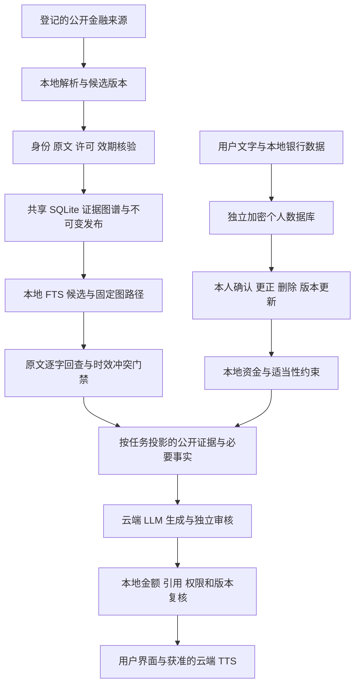

# Navren 本地知识图谱 RAG：实施与验收

下列 `/数据目录`、`/日志目录` 是部署路径占位，运行时需替换为自己的配置；示例命令执行前应在环境中配置所需密钥。

> 历史设计或实施记录：保留文内注明版本的测试结论，不能作为当前版本的验收结果。当前实现与运行方式见 [README](../README.md) 和 [技术说明](../TECHNICAL.md)。本机机器信息已清理，未发布的历史产物不提供仓库链接。

更新日期：2026-10-06。实现目录：`项目根目录`。

## 1. 本次落地的框架

采用本地 **SQLite + FTS5 + 有类型、可追溯的证据图谱**。原文保存、解析、对象映射、图关系构建、候选召回、固定路径检索、时效判断和证据回查均在本机执行，不调用生成模型。最终答复仍由云端 DeepSeek 生成、GLM 审核，获本地放行的答复可交云端 TTS。

这条链路控制“模型可以使用哪些事实，以及这些事实现在是否仍有效”。它不把图连接、检索分数或第二个模型的赞同视为事实真实性、经济因果或最优资产配置的证明。



## 2. GitHub 参考项目与实际选择

| 项目 | 借鉴点 | 在 Navren 中的取舍 |
| --- | --- | --- |
| [OpenSPG/KAG](https://github.com/OpenSPG/KAG) | 领域 schema、知识与原文相互关联、结构化与逻辑检索 | 借鉴本体和证据映射；未安装其完整 OpenSPG、Docker 与模型流水线 |
| [Neo4j GraphRAG Python](https://github.com/neo4j/neo4j-graphrag-python) | 检索器接口与受控图遍历 | 借鉴固定路径和提供器分层；原型使用 SQLite，不让模型生成任意 SQL/Cypher。官方 [检索文档](https://neo4j.com/docs/neo4j-graphrag-python/current/user_guide_rag.html)区分图遍历检索器与依赖 LLM 的 Text2Cypher |
| [HKUDS/LightRAG](https://github.com/HKUDS/LightRAG) | 实体与关系检索、增量更新、来源关联和删除 | 借鉴更新与溯源思想；其默认抽取与关键词流程含 LLM，未直接采用完整流水线 |
| [Microsoft GraphRAG](https://github.com/microsoft/graphrag) | 社区与全局检索研究 | 研究参考。项目 README 当前标示维护模式；默认图抽取与社区摘要依赖 LLM，Fast 流程也不等于可靠金融因果图，未选为本项目底座 |

因此，这是依据这些项目的设计思想完成的本地实现，不能称为已集成 KAG 或 Neo4j 软件包。许可证、来源和部署条件应在将来直接引入代码或服务时再按当时版本确认。

## 3. 共享证据图谱

实现：`local_knowledge/store.py`、`graph.py`、`importers.py`、`supplement.py`，使用独立的 `*.knowledge.sqlite3`。

### 数据层

- 来源登记：允许访问的固定端点、读取与出站许可、发布主体、解析器、各分析维度的时效策略。
- 原件与解析版本：原文摘要、发布日期、资料日期、效期、解析版本，以及可逐字回查的片段位置。
- 产品身份：产品、份额、渠道分开登记；渠道公开披露不自动等于基金份额映射、当前在售或可交易。
- 候选与发布：候选先核验，再进入封存的发布清单。一轮对话固定发布代次。
- 图实体、图关系与原文依据：`graph_entities`、`graph_relations`、`graph_provenance`。每条准入关系绑定原文版本、引用和位置。

### 检索层

FTS5 中文双字候选召回只是入口。输出必须通过固定类型的路径，例如：

`产品 / 份额 / 渠道 → 披露条款 → 规则维度`

`条款 → 文档版本 → 文档 → 已登记来源`

原文中的发行、管理和分销关系需要显式审核；模型和文本共现不能自行创建这类事实。图路径最大深度为 4，单个发布最多 5,000 个片段，单次结果与图路径有明确数量上限。

结果交给对话前，再检查发布成员、主体一致性、精确原文、当前许可、冲突、资料日期和效期。解析后的片段若混有失效维度，整段停止输出，避免把失效数值发给模型再要求它忽略。

### 更新、撤回和缺口

资料新鲜度由来源与字段共同设定，而不是统一“每天更新整库”。当前微众披露适配器的销售状态时效为当天，风险、费用、资格等为 7 天；官方市场全文的一般资料为 30 天。这是当前原型的保守配置，不是所有金融条款的通用规则。

正式合同的稳定条款可使用经核验的有效区间，市场行情、销售状态和净值需要相应的当前数据。发生撤权、冲突或已确认替代时，相关当前证据立即停用；历史版本保留供明确历史时点回查。

公开身份与金融字段时效分别管理。某产品的风险片段过期，不会令其曾经核验的公开产品 ID 变成私有信息；但候选名字、未准入身份及撤权来源不会进入公开身份目录。

未覆盖的问题返回固定缺口。`SupplementService` 只允许登记的公开对象和可信来源，限定并发、总时限、体积、缓存与同请求合并；抓取只形成候选，不自动写入正式发布、不切换本轮发布。未知产品必须先补身份登记与核验。

## 4. 个人数据库与用户隔离

实现：`personal_data.py`、`user_memory.py`、`personal_graph.py`。个人资料放在独立的 `*.personal.sqlite3`；共享金融库不存个人资料。

每个个人记录受服务器会话确定的 owner 限制；客户端不能凭传入用户 ID 读取别人的资料。个人正文采用 Fernet 加密，文件权限设为 `0600`。加密密钥仅通过环境变量或 macOS Keychain 加载，缺失时拒绝启动个人存储。数据库结构和必要索引仍是本地元数据，不等于整盘加密或银行级密钥体系。

对话中补充的个人信息先形成候选。确认绑定 `proposal_id`、服务器登记的原话 `source_ref`、确认令牌和 `expected_revision`，不能由客户端换一个 value 冒充原候选。更正、删除、设置变更和确认更新个人版本，失效相关历史、候选及已生成审核结果。HTTP 个人资料修改必须带预期版本，旧页面不能覆盖新资料。

旧个人内容按“导入 → 核验 → 提交 → 清理旧库”迁移，支持重试。未经证实的旧记录不会被提升为本人已确认事实。用户聊天与个人记忆不能修改正式银行余额、风险档案、授权或执行记录。

当前是**独立个人库文件中的 owner 隔离**，不是每个用户一个物理数据库，也没有完成大规模多租户部署。银行环境仍需租户/用户权限体系、密钥分层、备份恢复、审计留存和并发容量验证。

## 5. 云端交互边界

实现：`agent_runtime/data_boundary.py` 与 `conversation.py`。本地原始档案、历史和工具结果先经过任务字段投影；已知身份与业务 ID 使用本轮随机别名，凭据、电话号码、邮箱和可识别地址被去除。成批原始流水不能作为大段提示词直接上传。

必要金额与约束可以按任务提供，未知值保持未知。云端模型使用别名选择工具参数，本地恢复后由真正的银行工具再次校验权限。GLM 收到同样受限制的审核包，不能绕过边界查看完整档案。

在每次模型调用前、最终 JSON/SSE 返回时，以及 TTS 任务创建时，重新核验个人版本、隐私版本、银行上下文和引用状态。用户撤回记忆授权或修改数据后，旧证据和旧语音凭证不能继续使用。

TTS 只接受服务器签发的 `speech_receipt`；浏览器任意 text 不能直接成为云端语音输入。设置页试听使用服务器固定公开短句。最终语音不恢复真实身份别名。

原有 ASR 会将原始录音发到云端，无法预先筛除敏感信息，现默认关闭。界面暂使用文字输入；本地 ASR 尚未接入。LLM 和获准的 TTS 仍使用云端服务。

**实际边界限制：**目前是结构白名单、已知身份映射与确定性文本规则，不是完备的任意中文隐私识别器。未识别的新姓名、病情或特殊背景仍需更强的本地分类、实体识别及结构化输入约束；不能宣称已证明所有自由文本敏感信息都不会出站。真实银行采纳时，无论模型部署云端还是行内，证据准入、版本隔离与确定性复核依然有价值。

## 6. 实际资料与验收证据

真实导入报告：`outputs/local-rag-implementation/real-import.json`。

- 首次从现有市场库扫描 24 份资料，准入 12 份官方完整原文；另外 12 份因全文不完整或来源许可未核实被排除。
- 导入 24 份微众有日期的渠道披露，不据此声明当前在售、份额映射完整或具有交易授权。
- 首次发布共 386 个原文片段、872 个图实体、2,116 条有原文依据的关系；当时库体积约 9.27 MiB。后续同步可能变化，应以当前状态为准。
- 当日风险检索检测到披露过期，返回 `expired_evidence`、维度缺口与无已核验证据，阻止使用它作当前推荐依据。

本地自动验收脚本：`scripts/verify_local_rag.py`。默认创建临时银行、共享和个人三库，并禁止网络连接，检查图检索、撤回失效、加密、用户隔离、候选确认、个人版本、出库边界和 TTS 凭证。协议桩仅验证软件流程，不代表真实模型能力。`--knowledge-database` 模式仅以 SQLite 只读方式检查既有公开库，不创建个人库、不执行 schema 初始化。

自动测试、真实云端个案、运行服务结果与文件摘要统一记录在 `outputs/local-rag-implementation/validation.json`。真实云端脚本位于该目录的 `cloud-smoke.py`，只问公开证据过期问题，使用临时银行，不查询个人账户。这是一个连通性与缺口表达个案，不是金融推荐质量评测。

此前双模型正式复查只对应已批准架构，证据在 `outputs/architecture-review/20261005-231843/`；本次图谱实现经过本地测试和独立代码审查，不能把旧架构 PASS 当成本次实现的正式双模型审查结论。

## 7. 从这个底座走向高质量分析和资产配置

这一阶段落地证据与隐私底座。完整推荐还需要经验证的当前产品及份额映射、费用与赎回现金流、净值/底层持仓、适当性规则和资产配置研究依据。

后续分析应由本地模块先确定个人目标、期限、可承受损失、负债、应急资金和现金流约束，再根据已核验产品数据计算实际可投资金、费用、持有期和情景结果；模型负责解释结果和询问缺失条件。

资产配置求解应有明确目标函数、约束、估计窗口、币种、费用、再平衡规则与压力情景，并通过独立历史样本检验。相关性、波动率或同发行机构的图连接都不能直接推出最优权重。证据不足时应给出缺口与补充路径，不能生成貌似精确的仓位比例。

## 8. 本地操作入口

```bash
# 在克隆后的 Navren 项目根目录执行
.venv/bin/python scripts/verify_local_rag.py
.venv/bin/python scripts/sync_local_knowledge.py --database "/数据目录/simulated-bank.knowledge.sqlite3" --market-database "/数据目录/market.sqlite3" --webank --limit 24 --publish
env NAVREN_PORT=18767 .venv/bin/python -u server.py
```

同步命令显式访问已登记公开源；运行服务前应确认同端口没有旧 Navren 进程。不要关闭无关服务。
