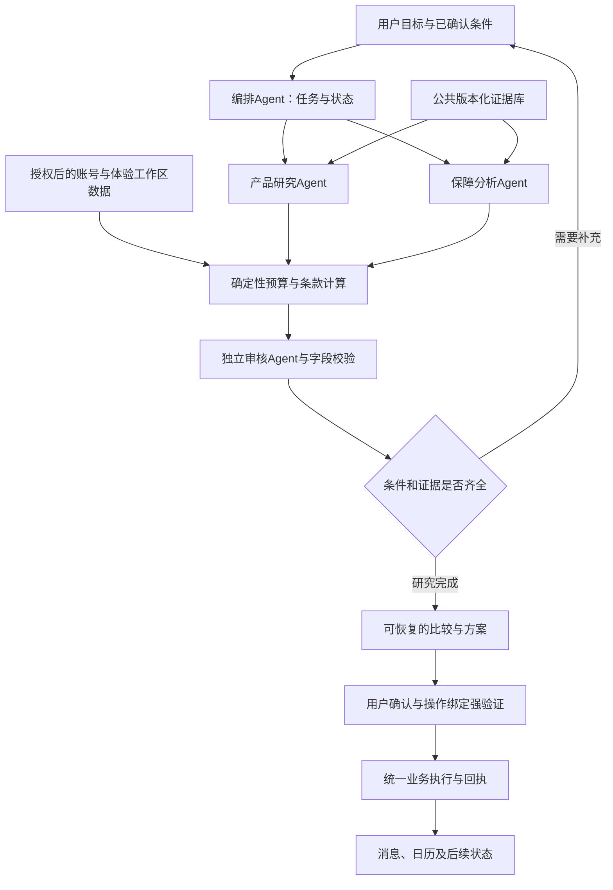

# Navren 产品研究与保险完整框架

> 设计与实施记录不代表当前整体已验收；本机原始收据不随仓库发布，当前入口见仓库 README。

研究日期：2026-10-18。状态：设计研究与公开资料核验完成，以下新增能力为实施方案；不表示已经开发、接线、部署或通过整体验收。本轮没有修改业务源码、私人账户数据库、现役服务配置或模型路由，没有启动外部模型审核。责任 owner：本次 Codex 规划会话。写入范围仅本文件及 `outputs/product-insurance-design-research-20261018/`。

**1．设计判断：两个板块应共同解决资金安排与保障决策**

产品研究应回答：这笔钱什么时候要用、能够承担什么风险、哪些产品符合条件、费用与退出有什么差别、为什么适合或不适合、接下来能完成什么任务。

保险应回答：谁或什么资产需要保障、已经记录了哪些保障、条款实际覆盖什么、有哪些尚未确认的限制、保费是否挤占必要现金、续保或理赔时下一步做什么。

统一主线是“需求与账本 → 证据支持的研究 → 条件匹配 → 用户选择 → 经授权的体验账户操作 → 回执、消息与日历持续跟踪”。首页保持简洁，深度放在详情、比较和任务工作区中。不能继续将近一周涨幅前三当作产品研究，也不能用保单数量代表保障充分。

**2．本轮实际核查的发现**

| 检查对象 | 当前证据与发现 | 必须进入新框架的约束 |
|---|---|---|
| 官网渠道目录 | 从微众官网正在使用的公开数据文件取得13,680条，原件 `extractDate=2026-10-14`，本轮10月18日读取 | 展示“资料截至10月14日”，不能将下载或校对时间改成产品事实日期；该原件不是获授权的交易API |
| 产品构成 | 开放式基金11,928条、理财产品1,589条、集合资管24条、集合信托88条、其他19条、保险32条 | 这些是渠道目录条目，含不同份额；不能宣称13,680款独立基金或全市场在售产品 |
| 保险客群 | 32条中个人8条、机构24条；个人目录含商业养老金、年金和医疗等不同机制 | 机构保险不能直接推荐给个人；商业养老金不能套用医疗险模板 |
| 目录字段 | 原件12个字段，不含完整保障责任、免责、健康告知、续保条款、完整赎回规则或连续净值 | 目录只能完成发现与初步身份定位，不能生成不存在的条款或完整测算 |
| 费用内容 | 12,065条写“详见产品页面”、1,589条写“详见产品页”、26条写“以保险公司核定为准”；可直接识别的具体金额／费率为0条 | 非空不代表费用已披露，更不代表可计算；逐份额、逐渠道、逐持有期补文件 |
| 主体字段 | 目录003003与000581的 `publish` 均出现“易方达基金管理有限公司”；独立管理人资料分别对应华夏与嘉实 | 这是待调查的主体字段冲突线索，不静默改原件、不按名称猜管理人，也不将这两条直接加入已核实产品池 |
| 风险标签 | 微众目录的华夏新起点A/C为R4，管理人页面为R3 | 保存“评级主体＋评级时点＋适用渠道”，不同评级口径可以并存；适当性采用实际销售渠道所要求的有效规则，不能自行选较低等级 |
| 首页实现 | `product_research.py` 对可用近1周收益按降序取前三，收益来源为天天基金／东方财富公开数据与微众目录的交集 | 当前是某一口径的浏览榜单，不是个人适配推荐；业绩来源不能都标成“微众官网” |
| 详情覆盖 | `product_performance.py` 已注册华夏、嘉实、西部利得三家管理人，首页候选却覆盖更大目录 | 上榜不代表有完整详情。进入研究展示前必须检查该条产品的实际资料能力 |
| 保险实现 | `insurance_needs.js` 组合已记录保单、资产、确认记忆和手选方向；`discover_insurance.js` 主要展示目录、费用文字和保单入口 | 可以复用入口与账号隔离，但仍需条款、具体保障对象、限制条件、诊断和后续任务 |

原始文件、SHA-256、抓取回执、完整统计、四项结构检查通过项及未覆盖项见研究目录。身份只独立抽查了上述两个代码，不能推断整个目录主体字段都正确或都错误。风险等级差异与主体冲突分开处理。

**3．与国内人工智能赛道的明确关系**

本轮实际打开官网国内规则和赛题解析核实：至少覆盖六个核心场景中的三个；人工智能赛道评分为任务完成40%、安全合规30%、创新及交互30%；作品提交截至11月2日，日期按北京时间。[S01]

| 赛题能力 | 两板块的落地证据 |
|---|---|
| 理财操作 | 从需求和风险评估进入同口径比较，确定性匹配、操作前重新校验、强验证、申购／赎回及状态读回 |
| 账单分析 | 从账本核实可用资金、周期性支出与保费，不用收支结余假装银行余额 |
| 订阅／代扣管理 | 保费与续费识别、保单及授权核对、提醒、取消请求的状态跟踪；取消代扣不等于保险合同已终止 |
| 跨场景联动 | 投资安排先留出保费和家庭必要支出；产品流动性与具体用款日联动；到期／续保进入日历和消息 |
| 安全 | 私有数据隔离、资料注入防御、字段证据检查、敏感操作确认及操作绑定强验证、未知结果查回执 |
| 创新与体验 | 用户可以追问“为什么排除”，查看逐字段来源、费用与期限的反事实比较，并在中断后恢复任务 |

保险不是官网列明的第七个核心场景，不能以新增保险页面替代“至少三个”的要求。它承担真实用户问题与跨场景创新的角色。Multi-Agent数量、页面数量、资料条目数均不是比赛完成度。

官网解析将理财申购列入红色强验证。登录验证码、普通“确认”按钮不自动等同于针对当前交易的强验证；实施须沿用统一权限系统，绑定操作对象、金额、版本与有效期。现有未通过的安全门仍需按原合同完成。

**4．产品研究的完整页面与内容**

| 层级 | 具体内容 | 用户可执行动作 |
|---|---|---|
| 发现首页 | 按现金安排、中长期投资、养老规划进入；结合已确认目标展示研究入口；普通浏览保留多周期业绩筛选 | 选目标、搜产品、继续未完成研究；未读取个人条件时明确为公开浏览 |
| 产品库 | 类型、币种、管理人、风险及其来源、最低金额、持有／开放机制、资料能力和时点；AC份额归在同一产品族下但分别列示 | 搜索、筛选、收藏、选2—3条比较；收益排序由用户主动选择 |
| 产品详情 | 概览、业绩与风险、费用与退出、组合与管理人、公告与资料、我的适配条件 | 原文定位、比较、加入研究方案、对话追问、条件完备时进入操作流程 |
| 比较工作区 | 同周期业绩、实际交易限制、流动性、费用阶梯、主要风险、资料缺口、排除原因 | 改金额或持有期后重新计算；保存和恢复方案；不能比较的项目解释原因 |
| 我的研究 | 已收藏、已比较、待补资料、已选方案、操作后跟踪、资料变更影响 | 继续研究、撤回草案、重新核验、取消不需要的提醒 |

首页三张卡片应表达三个研究方向或用户目标，不强制为收益最高三款。按目标进入后，首先校验约束、再解释候选；资料不足时不显示伪造的“匹配度92分”。

详情必须有的内容：

- 身份：基金／理财产品全称、代码、份额、币种、管理人／发行人、托管人、销售渠道与地区。品牌、渠道码、监管注册号分别保存。
- 收益机制：单位净值、累计净值、复权总回报、七日年化、万份收益、业绩比较基准分别使用对应字段和图表。基金、存款、净值型理财不能强行用一个“年收益率”字段。
- 风险：评级主体与有效日、市场／信用／流动性／汇率风险；历史回撤或波动率须有连续、明确期间且处理过分红的序列，不能将R4换算为具体损失率。
- 费用：申购费、销售服务费、管理托管等运作费、赎回阶梯、渠道折扣、税费及其适用条件。2026年销售费用规则已有更新，不能沿用旧营销页的费率结论。[S06]
- 退出：锁定与滚动持有、开放日、交易截止时间、确认日、到账范围、节假日、暂停公告、快速赎回额度及服务条件。不能以“T+1确认”承诺“T+1资金可用”。
- 组合：基金经理、规模、前十大持仓及行业分布采用实际披露期；不把季度组合称为今日实时持仓。
- 个人适配：目标日期、必要现金、负债及保费、已确认风险测评、资金来源。对话推断的风险偏好不得覆盖正式测评。

比较逻辑先做硬约束过滤，再在可比候选内给出取舍。首版不引入无验证的综合收益预测或黑箱推荐分数。保留被排除候选及原因，支持用户复核。

测算规则：含分红历史收益必须有分红／复权依据；没有时只画单位净值并说明图形定义。A/C费用比较按实际费率阶梯与持有期计算，不能用固定“几个月分界线”覆盖所有产品。实际净值已经反映的运作费用不再重复扣除。未来费用情景只计算费用影响，除非另有明确假设，否则不预测未来收益。不同来源／不同截止日／不同币种不直接做无条件排名。

**5．保险的完整页面与内容**

建议正式板块名为“保险与保障”。内部区分“我的保障”“保障研究”“续保与理赔协助”，目录范围中另标商业养老金／年金等产品机制。保留简洁的首页方向卡，深层内容通过对应入口展开。

| 功能 | 需要真正做到的内容 | 关键边界 |
|---|---|---|
| 我的保障 | 按被保险人、家庭成员、房产／车辆／设备等对象整理保单；时间轴展示生效、等待、续费、到期 | “已记录4份保单”不等于“已充分保障”；个人保单来自体验账户数据，与公开产品资料分开 |
| 保单档案 | 保险人、投保人／被保险人、产品及主附险、责任、限额、保额、免赔、赔付比例、保险期间、交费方式、特别约定、条款版本 | 营销名不能替代合同名；主险与附加险不能丢失关系；生效与等待期结束是不同日期 |
| 保障诊断 | 依已确认需求、责任范围和资料完整性给出“已核实覆盖／资料待补／可能重复／可能存在缺口” | 没上传保单不等于没保险；不从保单数量、资产价值或医疗消费推断已确诊疾病 |
| 产品研究 | 个人／机构分流；按保障对象和需求进入；比较责任、免责、续保、保费、理赔材料和服务 | 微众目录是主渠道范围；其他保险公司资料放“扩展研究”，不标成微众在售 |
| 情景核对 | 用户选择假设事件和费用，逐项检查责任、免赔、比例、限额、既往症／等待等条件 | 输出材料及条件核对或有条件估算；不承诺核保、承保或赔付结论 |
| 年金／养老金研究 | 缴费与领取现金流、保证与非保证利益、退保现金价值、领取条件、费用、养老资金占用 | 不将演示收益视为保证收益；不将商业养老金等同于所有人都适用的个人养老金账户税收政策 |
| 续保与理赔协助 | 续费提醒、材料清单、已递交／待补材料跟踪、服务入口、理赔进度记录 | AI可协助整理，保险公司决定是否续保／核保／理赔；不能伪造保险公司业务状态 |

保险比较至少覆盖：保障对象、投保年龄／职业／地区、保险期间、等待期、免赔及累计口径、赔付比例与分段、责任限额、医院／药品范围、既往症及免责、续保条件、保费与缴费、主附险、保全／理赔服务、对应条款版本。

保障缺口不能统一套一个减法。寿险等给付型责任可在相同保障对象、期间和目标下比较保额；费用补偿型医疗险不能把多份最高限额相加当成可领取金额。共用限额、年度累计限额、单项限额、免赔额与社保结算顺序须按条款分别建模。目标保额由用户确认或显式假设支持，不能由模型直接判定为“标准答案”。

保单／健康材料按敏感数据管理：单独说明用途并取得相应授权，只收集任务必需信息；公开检索不附带个人诊断、身份证号、保单号。云端分析必须经过已有披露授权与脱敏规则；不允许将私人附件进入共享公共RAG。附件先保存完整原件，解析结果待用户核对，未支持的解析类型明确待处理，不能只保存文件名假装已理解。

中国保险行业协会公开资料明确，人身保险产品库包含条款、销售状态以及费率表、现金价值表、说明书等信息入口；它适合作为核验入口，不等于本次已取齐全部文件，也不代表存在可自由批量使用的公开API。[S04]

**6．真实内容从哪里来，怎样填充**

默认保留“微众渠道目录”作为用户此前要求的渠道锚点。基金管理人、理财发行人和保险公司官网提供各自负责的产品事实；监管和协会提供制度与条款验证入口。事实要归因到真正提供该字段的来源。

| 来源层 | 负责内容 | 本轮实际状态／处理规则 |
|---|---|---|
| 微众产品查询及其公开原件 | 目录成员、渠道产品码、客群、渠道风险及资料日销售文字 | 已抓取原件并审计；并非实时交易权限、净值或全套合同 |
| 基金管理人官网 | 份额身份、公开净值及历史收益、合同、概要、费率、公告、季度组合 | 已验证华夏基金具体页面与文件；现有管理人适配器可复用，其他管理人逐个接入 |
| 理财发行人官网／中国理财网等验证入口 | 登记身份、说明书、净值、开放规则和公告 | 需要逐产品绑定；不得用公募基金代码或另一理财公司的文件补位 |
| 保险公司官网 | 正式条款、投保须知、费率、特别约定、医院／药品清单、服务手册、停售公告 | 本轮取得众安具体补充清单，完整合同匹配仍需补；清单不能冒充整份保险合同 |
| 保险业协会产品库 | 注册／备案标识、条款验证与资料入口 | 官网功能已核实；具体访问和再使用条件需逐项验证 |
| 监管官方文件 | 适当性、销售费用、披露等有效制度及生效日 | 作为规则背景和版本依据，不直接推导某只产品的实际费率或个人资格 |
| 第三方公开业绩 | 补充发现与交叉核验 | 当前首页实际使用东方财富；必须如实标明，验证使用条件；与官方不一致时保留冲突，不凭“更新”覆盖官方 |
| 用户／体验角色私有资料 | 账本、持仓、保单、确认的目标和偏好 | 属于独立账户域；体验数据仍为模拟，不能宣称已接微众真实客户账户 |

首批内容采用逐产品清单，而不是目标式“先凑几千款详情”：

| 对象 | 本轮已确认 | 继续填充的材料与状态 |
|---|---|---|
| 华夏新起点混合A 002604、C 008213 | 两份额均在渠道目录，管理人有对应公开页；渠道R4与管理人R3需要分别保存 | 核同一截止日的表现、最新版资料概要／合同、渠道费率、开放公告；适合做AC差异示例，尚不能宣布完整可推荐 |
| 华夏债券A/B 001001 | 渠道目录及管理人公开页身份可定位；本轮页面披露最新净值日为10月16日 | 继续取得费用与赎回条款、组合披露和分红。使用最新披露日，不能伪造成10月18日净值 |
| 华夏现金增利003003、嘉实活钱包000581 | 管理人官方资料可核对，与渠道 `publish` 字段存在冲突线索 | 原样保存并隔离关联，先查字段语义／渠道披露再决定修复。暂不当作完整推荐样本 |
| 众民保·中高端医疗险2026版 ZA260501 | 微众目录含该条个人产品；众安官网有同品牌方案、药械和康复医院清单 | 品牌名相同不等于计划、注册条款和渠道版本完全相同；补全正式合同／投保须知／费率及版本关系后才做完整责任比较 |
| 国民／太平养老等商业养老金、年金 | 微众个人目录可定位代码、产品文字和提供机构 | 按养老金／年金机制建模板；未取得现金价值及缴费领取资料前不计算IRR、不承诺退出金额 |
| 个人房屋／农业／设备保障 | 体验账户有相应资产或保单方向，不等于本次微众目录有个人可投产品 | 已有保单可以管理；新增公开产品先保留资料缺口。扩展来源如需纳入，明确为其他渠道研究 |

每一条深度产品至少形成“身份卡＋资料包＋字段表＋可比条件＋更新记录＋任务案例”。资料包缺项时列出具体缺什么，不用大段AI概述填空。

内容知识卡建议围绕真实任务制作：为什么高周涨幅不适合下月用钱；货币基金与存款的区别；开放日与到账日；A/C差异及费用已计入净值；百万医疗的保额与可报销金额；等待期与既往症；保证续保与可申请续保；商业养老金与个人养老金账户的区别。每张卡有官方依据、适用范围、更新时间和可以继续操作的问题，事实更新后同步失效重核。

**7．统一数据模型与证据框架**

不要在一张products表中混放所有事实，也不必为本次比赛新搭大量微服务。复用现有SQLite、公共provider、任务和账号存储，以明确领域表／对象逐步扩展。

| 数据对象 | 必需主键／关系 | 内容与边界 |
|---|---|---|
| institution | 稳定机构ID、角色、生效日 | 管理人、发行人、承保人、托管人、销售机构分开 |
| product_family / share_or_plan | 产品族ID、份额或方案ID、币种、发行人 | A/C分别记录；医保计划／主附险不能仅靠相似名称合并 |
| channel_offer | 渠道ID＋渠道码＋份额／方案＋版本 | 客群、地域、渠道风险、渠道费用、目录销售状态及其有效日 |
| source_document / snapshot | URL、SHA、文档类型、发布／生效／抓取时间、许可状态 | 保存原件，追加版本；主合同、补充清单、营销材料不能互相替代 |
| fact / evidence_binding | 字段路径、值、单位、适用对象、原文位置、来源版本 | 每个数字和责任条件可回到PDF页／条款／表格或网页字段；缺失、冲突、过期是状态，不是零 |
| market_observation | 份额＋日期＋指标定义＋来源版本 | 净值、七日年化、历史回报、基准分列；不同观察口径不覆盖 |
| contract_rule | 产品／份额／方案＋生效区间＋条款版本 | 费用阶梯、开放安排、保障和免责等确定性可执行规则 |
| research_task / comparison | 账号＋体验工作区＋任务ID＋版本 | 用户问题、条件、候选、排除原因、证据集、计算及审核结果、中断点 |
| policy / coverage / asset_relation | 账号＋工作区＋保单ID＋责任项 | 保单与承保合同、家庭成员／资产绑定；保额与责任限额分别建模 |
| obligation / reminder | 同一私有范围＋账务／合同／日历来源 | 具体保费、缴费日、宽限期、提醒偏好及实际状态 |
| calculation / review / operation_link | 输入版本集、算法版本、审核与操作ID | 保存可复算输入；研究方案不直接变成执行凭证 |

一个字段的建议表达：

```json
{
  "entity_id": "具体份额或保险方案的稳定ID",
  "field": "redemption.rules 或 coverage.waiting_period",
  "value": null,
  "unit": null,
  "state": "missing",
  "source_scope": "issuer_contract",
  "source_version": null,
  "effective_from": null,
  "effective_to": null,
  "locator": null,
  "missing_reason": "尚未取得与该份额/方案匹配的有效原文"
}
```

实际值只有对应原文取得后才能替换null。统一状态为已核实、缺失、冲突、过期、被替代、受限不可读；模型自报“置信度高”不能将它升级为已核实。

公开事实字段不带私人用户信息；私人任务按注册账号和体验工作区查询，权限来自服务端会话，不信任URL自填owner。共享缓存只存公开资料，不能缓存含个人账本、健康或方案的响应。跨浏览器／重新登录／重启从服务端恢复研究、收藏、保单档案、附件原件、提醒和操作关联。

**8．数据获取、版本与更新时间**

建议流水线：注册来源 → 限速读取／条件请求 → 原件存档 → 身份和版本定位 → 字段解析 → 确定性校验 → 冲突隔离 → 必要的条款复核 → 按能力发布 → 索引及消费 → 变更通知。

- 微众目录继续每5分钟条件检查；只有文件变化时解析。5分钟是检查间隔，不是承诺官网每5分钟更新。
- 基金净值按产品实际披露频率与交易日历检查。周末展示最后一个真实披露日；货币基金按其每日收益披露机制单独处理，不能一律停在周五。
- 公告和条款建议每日检查、用户深度研究／执行前再核；同URL内容改变也建立新snapshot，不覆盖旧合同事实。
- 保险方案、费率表、药械和医院清单独立版本。众安本轮文件明确存在不同启用时点与适用保单范围，不能将新清单套给全部旧保单。[S09]
- 保单、扣款、持仓及操作状态随事务更新；提醒由规则与日历触发，不靠模型每次访问重算或反复发送。
- 新鲜度按来源的预期更新方式、工作日历和关键性计算；不能所有数据统一“7天内都可用”。交易准备使用更严格的有效性要求。
- 来源变更时保留历史研究原件，标明哪些结论需要复核；用户历史保单继续绑定当时有效合同，不因官网替换文件自动改写权益。
- 来源不可用时保留有日期的最后有效版本，明确受影响字段；关键费用／退出／投保条件缺失时，只能继续公开研究，不能形成可执行依据。

访问公开网页不等于有稳定开放API或批量再分发许可。每个来源登记访问与使用条件、速率、允许缓存／引用范围，优先链接和必要字段摘要；遇验证码、访问控制或明确限制则使用官方允许入口或经授权资料，不绕过。

**9．Multi-Agent协作应如何真正落地**

使用现有Agent运行时扩展任务协议，不为凑“多智能体”名称重做模型渠道或引入新编排框架。建议四个逻辑角色，允许共享主模型提供商，但各自有独立职责、受限工具、输入上下文和结构化交付；现有独立审核模型角色继续保留。

| 角色 | 输入 | 交付与工具边界 |
|---|---|---|
| 任务编排Agent | 用户目标、已确认条件、当前任务状态 | 拆解任务DAG，决定是否需要追问／并行取资料，维护状态；不能签发金额或授权 |
| 产品研究Agent | 公开产品身份、允许披露的条件、版本化资料 | 产出候选及逐字段证据、适配与排除理由；不直接执行投资 |
| 保障分析Agent | 已授权的保单／资产摘要及对应条款、用户需求 | 产出覆盖矩阵、限制、待补材料和续费事项；不宣告承保或理赔成功 |
| 独立审核Agent | 研究草案、证据集、确定性计算和关键条件 | 核对是否遗漏、越权、混口径或无依据；退回定位到具体字段，不能代替业务权限守卫 |

金额、费率、预算、保费现金流、日期、权限、事务和回执由确定性后端负责，不包装为会“思考”的第五个Agent。普通浏览、抓取、筛选、曲线和固定提醒均不需要模型。



共享任务状态至少包含任务ID、账号工作区、目标与截止日、已确认条件、材料版本集、计算输入摘要、缺项、当前阶段、预算余额、审核结果、用户决策、操作ID。状态可在中断后恢复；晚到结果只有身份、任务及材料版本仍一致时才采用。

建议状态机：待澄清 → 取证中 → 可比较 → 分析中 → 审核中 → 已发布研究／待补条件／资料冲突；用户请求操作后再进入待确认 → 待强验证 → 执行中 → 成功／失败／结果未知。未知结果只能查询原操作，不能重发扣款。任何关键材料或个人条件改变都使旧操作准备失效，回到重核。

追问必须落在消息卡片里的单选、多选、金额／日期或确认／拒绝组件。用户已选择后移除原可操作按钮并保留所选结果；拒绝不触发写业务；对话来源引用随用户消息归档，不能悬留在输入框。尽量集中补齐本次确实需要的条件，不重复询问已确认信息。

公开文件作为不可信数据处理：原文中的提示词不能修改任务、工具权限或审核规则。模型返回的结构化字段仍须验证，不执行远程脚本、不任意打开新域名，不把文档里的银行账号当成用户授权的收款人。

**10．三条应完整演示的任务**

第一条：“这笔钱下个月要交保费和房租，剩下的钱怎么安排？”从体验账户核对可用资金、已确认账单与保费义务，计算需要留存的现金；比较与用款日相容的真实公开产品事实，解释为什么排除锁定期或到账不明产品；用户选择后按体验账户已有执行能力进入相应操作和强验证；最后查询账本、持仓／操作状态，并保留用款提醒。

第二条：“这两个A/C份额我打算持有一年，有什么区别？”绑定具体份额和同一日期资料，核实渠道实际费率与赎回条件，给出条件明确的费用比较和风险差异；改变持有期后重算并保留前一版。没有渠道费率就说明不可完成哪项计算，不能用基金类别默认费率补齐。

第三条：“这份医疗险到期前需要做什么？我已有的保障有哪些限制？”读取体验角色保单、合同版本、缴费记录和用户确认的家庭关系；对照等待、免责、续保和清单适用日期，列出待核事项；将续费和资料准备写入用户明确确认的日历／消息任务；保留材料与动作记录，切换账号及重登后仍能恢复。

三条任务同时展示真实公开产品事实和独立体验账户操作。体验数据的说明集中在角色选择环节；方案、测算的假设和不确定性仍需就地说明。产品官网上的真实申购链接与体验账户操作入口分开，不将模拟业务回执冒充实际基金申购或保险公司承保结果。

**11．复用清单与技术搭建顺序**

| 可复用资产 | 用途 | 本轮识别的新增部分 |
|---|---|---|
| `webank_catalog.py`、现有同步脚本 | 渠道目录、原件及同步状态 | 来源语义核验、规范产品身份、字段冲突与完整度 |
| `product_performance.py`、`product_research.py` | 公布净值／业绩、请求去重、缓存及已有来源约束 | 分离浏览榜单与适配研究；扩管理人时逐家验；补条款、费率、开放及组合材料 |
| `local_knowledge`与现有产品研究Skill | 文档检索、引用及公开／私有provider边界 | 页码／表格级证据、产品族／份额／方案关系、适用版本及冲突处理 |
| `insurance_needs.js`、`discover_insurance.js` | 关注方向、保单／资产关联和账号事件 | 迁移核心诊断到服务端；补合同规则、保单档案、情景核对和后续任务 |
| 金融方法、预算、财务图谱 | 精确计算、资产关系、义务与资金来源 | 增加费用比较、保障责任及现金流算法合同；不直接合并不同赔付机制 |
| 统一操作、历史、确认与安全机制 | 体验账户执行、回执、幂等与恢复 | 研究到操作的明确映射；证据版本和操作绑定；不由前端按钮直接修改余额 |
| 消息、日历、账号存储及附件存储 | 提醒、持久任务、跨浏览器恢复 | 资料变更／保单到期消息类型；去重、偏好和原件恢复验收 |
| 现有Chart.js、表单控件与安静焦点样式 | 曲线、筛选、比较与日期输入 | 不再引入另一套图表／表单框架；复用统一交互和无障碍规范 |

首版使用现有SQLite／索引和受限provider即可。暂不新建分布式微服务、全市场知识图谱或重型本地OCR集群。新增PDF工具先核现有依赖和许可证；当前8GiB机器以文本层解析、受控队列和按需处理为主，图像解析作为明确能力与资源依赖，不默认已经支持。复用候选按许可、维护、数据覆盖和实际接线结果决定，不按项目名气引入。

普通数据同步、图表与提醒零模型调用；只有需要理解用户目标、综合条款和解释取舍时才调用相应Agent，最终研究复用现有独立审核。按源版本缓存公开事实和已审核公开说明，私人结论绑定用户／工作区／条件版本，不能跨账号复用。每项任务记录模型调用数、延迟、token和预算上限；本研究没有给未经测量的生产成本或性能承诺。

**12．实施分包与依赖门**

| 顺序 | 责任模块建议 | 交付物 | 进入下一步的条件 |
|---|---|---|---|
| 0 数据与能力冻结 | 规划＋RAG＋基座 | 本设计、字段清单、身份冲突清单、可复用模块、统一对象合同 | 已有真实资料与候选缺口写清；每个文件确认唯一owner |
| 1 公共资料层 | RAG／数据owner | 真实目录、版本化原件、份额／方案身份、条款字段、字段证据与覆盖报告 | 未披露、冲突、过期会被消费者识别；先做少量完整资料包再扩覆盖 |
| 2 领域计算层 | 金融方法＋基座 | 费用、资金义务、日期及保障规则计算合同、正式权限与持久数据结构 | 金额可复算，条件不全有明确状态，账号和角色隔离成立 |
| 3 产品与交互 | UI | 首页、目录、详情、对比、保单档案及任务状态；真实字段联动 | 不编造空字段，来源可定位，所有交互可完成且选择后状态正确 |
| 4 Agent消费 | Agent＋RAG＋基座 | 任务DAG、工具/Skill输入输出、证据与审核交接、研究到操作映射 | 合法任务和拒绝负例在同版接线通过，身份及证据版本全程一致 |
| 5 集成验收与材料 | 集成＋规划 | 三条完整任务、故障与隔离证据、技术图、安全自评、可复现演示 | 原完整验收与安全门均满足后再正式采用，不拿局部通过冒充整体验收 |

本表是分包建议，未派发其他会话，也不占用原业务文件写入权。用户确认实施方向后，按现有会话映射检查当前工作、文件owner和交付再分发。原主流程待验事项继续保留；不因这份方案开启Jev对照或恢复已停止的外部开发送审。

离11月2日提交约15个自然日，不能把全市场所有产品的全部条款抓取作为交付前置。整体架构要完整，首个可验范围建议为4个身份无冲突、资料齐全的基金份额（含一组AC）、2个完整保险方案，加1条独立养老金研究样本；这些是建议的首批验收对象数，不是当前已完成数量或官方门槛。其余目录仍可浏览，但深度能力按实标注。精确排期在owner确认资料可得性、缺失接口和同版联调后估算，不能依据页面数量承诺工期。

**13．验收标准与效果证据**

| 检查域 | 建议验收门与具体负例 |
|---|---|
| 原件与身份 | 进入深度研究池的每项关键事实有有效原文绑定；不同份额／渠道／保险方案不混；003003、000581主体冲突必须被隔离；不能凭名称自动修正 |
| 指标口径 | 日期、币种、单位、收益定义和评级主体完整；七日年化与历史涨幅不能混排；管理人R3与渠道R4同时存在而不互相覆盖 |
| 字段完整性 | 按“有意义且有证据的字段／该类产品必需字段”计算；“详见页面”、0、空字符串不能自动计入；来源受限与未披露分开 |
| 确定性计算 | 费用阶梯、分红、日期与节假日、分段赔付／共用限额有人工独立算例；RAG或模型输出不直接决定数值 |
| 任务完成 | 固定三条正例从问题到最终状态读回；更换未见过的措辞和同类产品仍可完成；不只验证预设按钮问题 |
| 权限与确认 | 无确认不写业务；高风险操作缺少绑定强验证必须阻止；对话和资料注入不能授权；旧版本确认不可使用 |
| 账号与角色 | 不同注册账号和不同体验角色不串任务、保单、提醒、收藏、附件、持仓或回执；公开事实可共享，个人研究不可共享 |
| 恢复 | 换浏览器、退出重登、服务／进程重启恢复任务与附件原件；超时结果未知查回执、不重复扣款；删除单条记忆不删除研究和聊天 |
| 变更与时效 | 新合同不覆盖老保单权益；旧版本研究标为需重核；周末不伪造新净值；抓取成功不能重置资料日 |
| 体验与无障碍 | 主卡简洁，比较字段能定位来源；键盘完成筛选、日期、对比和确认；按钮已选即退出待答状态；加载失败有保留上下文的重试 |
| 成本与延迟 | 普通浏览／定时提醒模型调用为0；记录每条复杂任务的实际调用、token、时延与缓存命中，按同题对照，不先编造提升百分比 |

建议冻结24个领域验收案例：8个产品研究、8个保险／保单、8个跨场景与安全恢复。其中必须含身份冲突、AC份额、渠道风险不同、缺少费率、周末净值、停售、共用赔付限额、健康隐私、条款版本、强验证、并发确认和跨账号晚到响应。24仅为本设计新增领域用例集建议，不替代现有强制安全题集。真实模型成绩只能来自后续批准且预算覆盖的同版测试，本轮没有运行。

竞赛效果应报告任务完成率、关键字段证据覆盖、金额复算差异、无依据关键结论数、非法写入数、恢复成功率、用户完成时间和实际模型成本。若要证明Multi-Agent的价值，以同一题集和同一证据比较原流程与新协作流程；先看错误类型、工具与审核链，再讨论提升，不能从架构图直接得出“准确率更高”。

**14．来源与本轮产物**

- [S01 大赛官网及国内规则、赛题解析](https://fintechathon.g-ican.com/#/rule)。本轮浏览器实际读取动态页面，证据保存为`contest-rule-visible.txt`及`contest-task-visible.txt`，不是只读页面空壳。
- [S02 微众官方产品查询](https://www.webank.com/inquiryCenter/query)；[对应公开目录原件](https://tctp.tctpwebankcdn.net/owb-admin/data/appsystems/owb-admin/productpresentation.json)。目录字段和统计来自本轮原件，不从搜索引擎摘要估计。
- [S03 华夏新起点A管理人页面](https://www.chinaamc.com/fund/002604/index.shtml)、[C管理人页面](https://www.chinaamc.com/fund/008213/index.shtml)、[华夏债券A/B](https://www.chinaamc.com/fund/001001/index.shtml)。本轮保存网页原件；页面具体数字仅在其披露日有效。
- [S04 保险业协会：人身保险产品信息库升级说明](https://www.iachina.cn/art/2023/8/17/art_22_107111.html)。仅使用其公开查询范围，不将2023年历史总量写成2026年当前数量。
- [S05 金融监管总局发布适当性管理办法说明](https://www.nfra.gov.cn/cn/view/pages/governmentDetail.html?docId=1217123&itemId=861)、[办法官方条目](https://www.nfra.gov.cn/cn/view/pages/governmentDetail.html?docId=1217183&generaltype=0&itemId=861)。2026年2月1日起施行；作为设计依据，不宣称本比赛原型取得金融销售资质。
- [S06 证监会修订发布基金销售费用管理规定](https://www.csrc.gov.cn/csrc/c100028/c7606047/content.shtml)、[正式公告](https://www.csrc.gov.cn/csrc/c101954/c7606091/content.shtml)。2026年1月1日起施行；具体产品仍需匹配实际有效文件及渠道费用。
- [S07 证监会业绩比较基准指引](https://www.csrc.gov.cn/csrc/c101954/c7610812/content.shtml)。2026年3月1日起施行；设计中分别管理基准和历史收益。
- [S08 华夏003003资料概要PDF](https://www.chinaamc.com/upload/resources/file/2026/05/29/15e6bd14c8244fd9a8e849a989ec476d.pdf)、[嘉实官网货币基金帮助页](https://www.jsfund.cn/main/a/20201119/481980.shtml)。用于身份核对，嘉实帮助页不能直接证明当前微众渠道的额度与规则。
- [S09 众安具体药械范围文件](https://static.zhongan.com/upload/online/material/1782115165001.pdf)、[指定康复医院清单](https://static.zhongan.com/upload/online/material/1773655268058.pdf)、[众安官方产品列表](https://www.zhongan.com/productlist/31-41)。补充清单、营销方案和主合同分开；不能推断与微众ZA260501全部计划完全一致。
- [S10 保险业协会保险产品适当性管理自律规范](https://www.iachina.cn/module/download/downfile.jsp?classid=0&filename=deb2f08eefea4cf9953ff635367f4862.pdf)。保险产品复杂度与风险／保障需求分别建模，不简单复用基金R1—R5。

研究目录中的`http-source-receipts.json`、`document-source-receipts.json`和`raw/`保存本轮来源与校验值；`catalog-audit-report.json`包含通过项、两个待核主体冲突与未覆盖项；`insurance-research-seed.json`保存32条真实渠道条目的研究种子，合同和当前购买资格仍为待核，不是可执行保险数据库。`audit_public_catalog.py`可复算结构、分流、完整性和日期统计。

本轮完成的是可供分工实施的设计、来源核查和公开目录审计。完整条款库、深度比较、保障诊断、Multi-Agent协作新增消费与操作映射仍待按本文件分包实施，未用研究文档替代运行验收。
